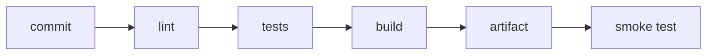

**Where you are:** you already know how to review a change, put the application on a server, and package it. All of that still depends on somebody doing it, and doing it right. Here a commit stops needing a person in order to become a checked artifact.

## Checking where nobody has an advantage

Until now, whoever wrote the code was also the one checking that it worked, on the one machine where everything was already installed. That makes "it works on my machine" literally true and completely useless.

**Continuous integration** moves the check to a clean server created for the attempt and destroyed when it ends. Nobody has an advantage there: if the build depends on an environment variable that only exists on your laptop, it fails, and it fails at the moment when fixing it is cheap.

## A test is a claim that runs

What that server runs is, above all, tests. An automated test claims something specific: given a certain input, the system responds a certain way. When it fails, nobody argues opinions; you read reproducible evidence.

If you already code, this is probably not new. What changes here is where the suite lives: it stops being a check you run when you remember and becomes a **gate on the delivery path**. It runs by itself on every change and its result decides whether the artifact keeps moving.

:::note[A test that never fails protects nothing]
If a test always passes, even when you break the code, it is not testing what you think. A good test fails when the behaviour changes.
:::

## Three words you will read a lot

- **Pipeline**: the automated sequence of stages a change travels from commit to published. Each stage leaves evidence and can stop the change from going further.
- **Artifact**: the packaged result of a build — a container image, a `.jar`, a folder of static files. It is what gets deployed, and it is not the same thing as the code it came from.
- **Environment**: a complete installation of the system, with its own configuration and its own data. Three is the common setup — development, staging, and **production** — and only the last one has real users.

## The integration chain

The order matters: cheap things go first. A lint that takes ten seconds should fail before a suite that takes eight minutes, because the feedback that arrives first is the feedback that gets used.

## The route

| Moment | Question | Page |
| --- | --- | --- |
| Workflow | How do I describe an automated check? | [GitHub Actions](/en/integration/github-actions/) |
| Levels | What should be tested, and at which level? | [The testing pyramid](/en/integration/pyramid/) |
| Evidence | How do tests run on every change? | [Tests in CI](/en/integration/tests-in-ci/) |
| Branches | Which branching model supports the way I deliver? | [Branching strategies](/en/integration/branching-strategy/) |
| Access | Where do the credentials the pipeline needs live? | [Secrets and permissions](/en/integration/secrets/) |
| Practice | Can I leave a test and a workflow running? | [Practice · a test and a workflow](/en/integration/lab-ci/) |

:::note[A check nobody looks at is not a gate]
If the workflow fails often for reasons that are not the code — an unstable dependency, a badly set timeout — the team learns to ignore the red. A check that gets ignored costs the same and protects nothing.
:::

## What you can do with this

These pages let you choose what to test and at which level, write a workflow that validates every pull request and verifies the image it builds, choose a branching model and justify it, and give the pipeline only the permissions it needs.

## Where this breaks

| Symptom | What causes it | Where it continues |
| --- | --- | --- |
| The artifact is checked and somebody still SSHes in to copy it across | The automation ends at the registry and never reaches the server | [Deploying from the pipeline](/en/deployment/deploy-from-pipeline/) |
| Updating leaves the application down for a few seconds | The process is replaced in place, with nothing to take the traffic meanwhile | [Deployment strategies](/en/deployment/strategies/) |
| A green suite says nothing about what is already in production | A test makes a claim about the code, not about the running service | [Observability](/en/scaling/observability/) |
