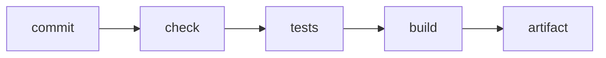

**Where you are:** you already know how to review a change and how to package the application. What is missing is having all of that happen on its own. Here a commit stops needing a person in order to become a checked artifact.

## Checking where nobody has an advantage

Until now, whoever wrote the code was also the one checking that it worked, on the one machine where everything was already installed. That makes "it works on my machine" literally true and completely useless.

**Continuous integration** moves the check to a clean server created for the attempt and destroyed when it ends. Nobody has an advantage there: if the build depends on an environment variable that only exists on your laptop, it fails, and it fails at the moment when fixing it is cheap.

## Three words you will read a lot

- **Pipeline**: the automated sequence of stages a change travels from commit to published. Each stage leaves evidence and can stop the change from going further.
- **Artifact**: the packaged result of a build — a container image, a `.jar`, a folder of static files. It is what gets deployed, and it is not the same thing as the code it came from.
- **Environment**: a complete installation of the system, with its own configuration and its own data. Three is the common setup — development, staging, and **production** — and only the last one has real users.

## The integration chain

The order matters: cheap things go first. A lint that takes ten seconds should fail before a suite that takes eight minutes, because the feedback that arrives first is the feedback that gets used.

## Module map

| Moment | Question | Page |
| --- | --- | --- |
| Workflow | How do I describe an automated check? | [GitHub Actions](/en/integration/github-actions/) |
| Branches | Which branching model supports the way I deliver? | [Branching strategies](/en/integration/branching-strategy/) |
| Evidence | How do tests run on every change? | [Tests in CI](/en/integration/tests-in-ci/) |

:::note[A check nobody looks at is not a gate]
If the workflow fails often for reasons that are not the code — an unstable dependency, a badly set timeout — the team learns to ignore the red. A check that gets ignored costs the same and protects nothing.
:::

## What you can do with this

These pages let you write a workflow that validates every pull request, choose a branching model and justify it, and order the steps so feedback arrives in the right order.

## Where this breaks

| Symptom | What causes it | Where it continues |
| --- | --- | --- |
| The artifact is checked and somebody still SSHes in to copy it across | The automation ends at the registry and never reaches the server | [From build to release](/en/deployment/pipeline/) |
| Updating leaves the application down for a few seconds | The process is replaced in place, with nothing to take the traffic meanwhile | [Deployment strategies](/en/deployment/strategies/) |
| The deployment finished cleanly and nobody knows whether the service is healthy | Evidence stops at the pipeline instead of continuing into production | [Observability](/en/deployment/observability/) |
