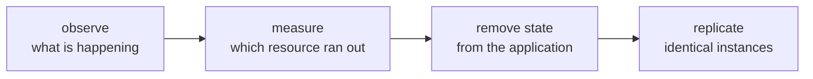

**Where you are:** you have a server serving traffic, a pipeline that deploys on its own, and the ability to roll back. Here begin the questions with no single technical answer, because they depend on numbers only you can measure.

## Growing is not buying machines

The usual picture of scaling — adding servers — describes the last step and hides the three before it. In the order things actually happen:

The first two steps prevent unnecessary spending: what looks like missing capacity can be a query with no index. The third is the one that takes the most work. The fourth is nearly mechanical once the others are done.

## What limits one server has

| Limit | How it shows up | Where it is resolved |
| --- | --- | --- |
| You do not know what is happening inside | You learn about outages from a user's message | [Observability](/en/scaling/observability/) |
| One specific resource runs out | Latency that climbs with traffic | [When to scale, and how](/en/scaling/when-to-scale/) |
| The data lives on the same disk | Replicating the application breaks sessions and files | [Moving state off the machine](/en/scaling/managed-services/) |
| With several machines, somebody spreads by hand | A deployment is many repeated manual steps | [Orchestration](/en/scaling/orchestration/) |

## Every step costs operations

That table is not a ladder to be climbed whole. Each step adds pieces you have to understand when they fail.

A well-operated VPS — tested backups, a certificate that renews itself, an automated deployment — leaves a fair amount of headroom. The useful question is which measurement says it is no longer enough.

:::note[Fewer pieces]
It pays to carry the real load with the fewest pieces the team can operate well. Sometimes that is a bigger machine.
:::

## What this covers

These pages cover how to instrument a service and read its signals, the difference between an efficiency problem and a capacity one, how to move state out of the instances, and when an orchestrator is worth it.

## Where this breaks

| Symptom | What causes it | Where it continues |
| --- | --- | --- |
| The second machine does not come out like the first | The steps to build it are still written nowhere | [Infrastructure as code](/en/infrastructure/) |
| An urgent fix was applied on one server and not the others | There is no common definition to compare against | [Why write infrastructure down](/en/infrastructure/why-iac/) |
| Creating the staging environment is an afternoon of manual work again | Resources are requested through a web panel, so they cannot be repeated | [Terraform and state](/en/infrastructure/terraform/) |
