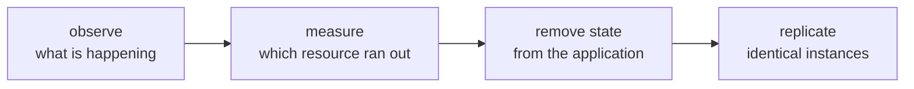

**Where you are:** you have a server serving traffic, a pipeline that deploys on its own, and the ability to roll back. Here begin the questions with no single technical answer, because they depend on numbers only you can measure.

## Growing is not buying machines

The usual picture of scaling — adding servers — describes the last step and hides the three before it. In the order things actually happen:

The first two steps prevent most unnecessary spending: a good share of what looks like missing capacity is a query with no index. The third is the real work, and the only one you cannot buy. The fourth is nearly mechanical once the others are done.

## What limits one server has

| Limit | How it shows up | Where it is resolved |
| --- | --- | --- |
| You do not know what is happening inside | You learn about outages from a user's message | [Observability](/en/scaling/observability/) |
| One specific resource runs out | Latency that climbs with traffic | [When to scale, and how](/en/scaling/when-to-scale/) |
| The data lives on the same disk | Replicating the application breaks sessions and files | [Moving state off the machine](/en/scaling/managed-services/) |
| With several machines, somebody spreads by hand | A deployment is many repeated manual steps | [Orchestration](/en/scaling/orchestration/) |

## Every step costs operations

It is tempting to read that table as a ladder to be climbed whole. It is not. Each step adds pieces you have to understand when they fail, and the most reliable system is the one with the fewest things that can fail.

A well-operated VPS — tested backups, a certificate that renews itself, an automated deployment — serves more traffic than most projects ever see. The useful question is not "how do I scale", but "which measurement tells me this is no longer enough".

:::note[Scaling is not a sign of maturity]
A system is not better for having more parts. The right decision is the one that carries your real load with the fewest pieces your team can operate well. Sometimes that decision is a bigger machine, and there is nothing to justify.
:::

## What you can do with this

These pages let you instrument a service, read its signals, tell an efficiency problem from a capacity one, move state out of your instances, and judge whether an orchestrator is worth it to you.

## Where this breaks

| Symptom | What causes it | Where it continues |
| --- | --- | --- |
| The second machine does not come out like the first | The steps to build it are still written nowhere | [Infrastructure as code](/en/infrastructure/) |
| An urgent fix was applied on one server and not the others | There is no common definition to compare against | [Why write infrastructure down](/en/infrastructure/why-iac/) |
| Creating the staging environment is an afternoon of manual work again | Resources are requested through a web panel, so they cannot be repeated | [Terraform and state](/en/infrastructure/terraform/) |
