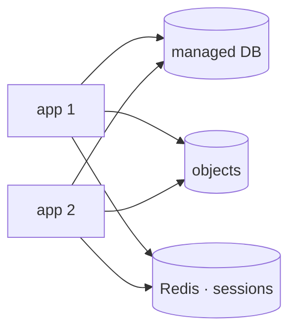

## What holds state on your server

Before replicating anything, you need to know what replicating would break. **State** is anything that outlives a request and that another instance would not have.

| What is on the machine | Does it hold state? | Where it should live |
| --- | --- | --- |
| The code and dependencies | No | The image or the repository |
| The database | Yes | A service of its own |
| Files users upload | Yes | Object storage |
| Sessions in memory | Yes | Redis or the database |
| The process's in-memory cache | Partly | Redis, or accept losing it |
| Logs in `/var/log` | Yes | An external collector |
| Scheduled jobs in `cron` | Yes, in fact | A scheduler with locking |

The first three rows are the ones that take work. The rest almost solve themselves once those are done.

## The database: managed, or yours

This is the heaviest decision and it has no single answer. What you buy by paying for a managed one is not features — PostgreSQL is the same — but **operations**: backups with point-in-time recovery, replicas, version upgrades, failover, and somebody to call at 3 a.m.

| | You operate it | Managed |
| --- | --- | --- |
| Monthly cost | Low | 2× to 5× |
| Backups and testing them | Your responsibility | Included |
| Version upgrades | Your maintenance window | Scheduled |
| Point-in-time recovery | Has to be built | One button |
| Read replicas | Real work | One button |
| Fine tuning | Full control | Limited by the provider |

The practical rule: if nobody on the team can say right now when a backup was last restored, you are already paying the price of operating it — just in risk instead of in invoice.

:::note[Leaving a managed service is harder than joining one]
The migration in is a `pg_dump` and a `pg_restore`. The migration out is too, but by then you depend on their backups, their replicas and sometimes on extensions only that provider offers. It is worth knowing, the day you join, what leaving would look like.
:::

## Files: from a disk to a service

A file uploaded to `/srv/myapp/uploads` lives on one machine. With two instances, half the downloads do not find it.

**Object storage** — S3 and its equivalents — solves that by turning the file into something requested over HTTP from a service rather than from a disk. Three problems disappear at once: capacity stops being a fixed number, cross-region copies become configuration, and the file can be served from a CDN without touching your application.

Two details that get forgotten in the migration:

- **Existing URLs.** If your files were served from `/uploads/photo.jpg`, that path has to keep working, even if only by redirecting to the new object.
- **Uploads should not pass through your server.** The usual pattern is the *presigned URL*: your application signs a temporary permission and the browser uploads straight to storage. That way a 500 MB upload does not occupy one of your processes for minutes.

When the diagram looks like this, the instances are genuinely interchangeable: any of them serves any request, and deleting one loses nothing.

## Sessions and scheduled jobs

In-memory **sessions** are the state noticed fastest: the user signs in and the next request asks them to sign in again. They move to Redis or the database, and it is usually a framework configuration change.

**Scheduled jobs** are the state noticed latest, which is what makes them the most expensive. A `cron` sending the daily digest, replicated across three instances, sends three emails to every person. The way out is having only one instance run it: a shared lock, or an external scheduler that fires the job once.

## Check your understanding

You migrate to two instances and users see "file not found" half the time. What is happening?

The uploaded files are on the disk of one of the two machines. Requests landing on the other do not find them, and which one you get depends on the balancer. They have to move to object storage, which both instances reach equally.

What exactly do you buy with a managed database?

Operations, not features. The engine is the same. What you pay for is somebody else taking and testing the backups, keeping the replicas, applying upgrades, and answering when something breaks overnight. If your team already does all of that well, the price buys nothing.

Your daily digest cron now sends three emails to every user. Why, and how is it fixed?

Because the three instances are identical, `cron` included, and all three run the job. It is fixed by having only one run it: take a shared lock before starting, or move the scheduling outside the instances so a scheduler fires the job exactly once.

## Keep exploring

- [The Twelve-Factor App · backing services](https://12factor.net/backing-services) — treating every dependency as an attachable resource.
- [AWS · presigned URLs](https://docs.aws.amazon.com/AmazonS3/latest/userguide/using-presigned-url.html) — uploading without going through your server.
