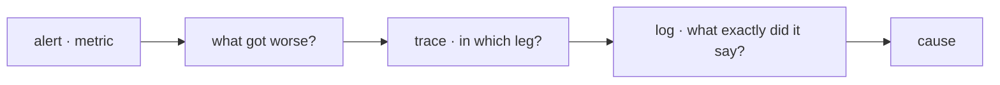

## You deployed. Now what?

The tests proved the code does what it claims, under conditions you chose. Production is the other thing: real users, real data, a network that fails, a dependency that stalls. None of that fits in a test suite.

The question after a deployment is not "does it work?". It is **what is the system doing right now, and how does that differ from ten minutes ago**. An observable system can answer that without you deploying anything new to find out.

That is the difference between monitoring and observing. Monitoring watches the questions you already knew to ask — a dashboard with CPU and memory. **Observability** is being able to answer questions you did not anticipate: why exactly these users see errors, why only from the mobile app, why only since yesterday's release.

## Three signals

Almost everything you will install and configure falls into one of three categories, and each answers a different question.

| Signal | What it answers | Cost |
| --- | --- | --- |
| **Metrics** | How much, how often, since when? | Cheap: they are aggregated numbers |
| **Traces** | Where did the time go inside this request? | Medium: usually sampled |
| **Logs** | What exactly happened in this one case? | Expensive: grows with traffic |

**Metrics** are numbers measured over time: requests per second, errors per minute, milliseconds to respond, memory in use. They are cheap to keep and perfect for trends and alerts. What they do not tell you is *why*.

```text
http_requests_total{route="/api/orders",status="500"}  1428
http_request_duration_seconds{route="/api/orders",quantile="0.99"}  2.4
```

**Traces** follow one request across every service it passes through and measure how long each leg took. In a system made of several pieces, it is the only signal that answers "is the slow one the service or the database?".

**Logs** are the event-by-event record. They serve the specific case: this user, at this time, with this error. Two habits make them genuinely useful:

- **Write them structured**, as JSON with fields rather than loose sentences. A sentence is read; a field is filtered and aggregated.
- **Carry a correlation id**: the same id on every log line of one request, so its whole path can be reconstructed.

```json
{"ts":"2026-07-26T10:14:02Z","level":"error","request_id":"a1b2c3","route":"/api/orders","status":500,"msg":"payment gateway timeout"}
```

## What to measure

A system produces far more numbers than you need to look at. Four signals describe the health of a service:

- **Latency** — how long it takes to answer. Keep successful and failed responses apart: an error returned quickly is not good news.
- **Traffic** — how much demand it is receiving.
- **Errors** — what fraction of requests fails, including those that return `200` with the wrong body.
- **Saturation** — how full the most constrained resource is (CPU, memory, database connections, job queue).

And measure them **at the boundary where the user notices them**: at the proxy or the edge of your API, not only inside the process. A service can look perfectly healthy while the queue in front of it grows.

:::caution[The average lies]
If half your users are answered in 50 ms and the other half in 4 s, the average says 2 s and describes nobody's experience. Use percentiles: the **p95** is what 1 request in 20 suffers, and the **p99** is what your most active users suffer, precisely because they make more requests.
:::

## After a deployment

This is where it connects to deployment. A deployment does not end when the new version boots; it ends when you have checked that it behaves like the previous one. In the first minutes, compare **the new version against the one already running**:

- Error rate: did it rise compared with the previous version?
- p95 and p99 latency: did it degrade?
- Saturation: does the new version consume far more for the same work?

That is exactly what "if the metrics stay healthy" meant in a [canary](/en/deployment/strategies/): not a hunch, but those three numbers compared between the two versions serving traffic at once. If they get worse, you pull the canary before it reaches everybody else.

A **health check** — the one you met at [the proxy](/en/deployment/load-balancing/) — only answers "can it serve?". Observability answers "is it serving well?". Neither replaces the other.

## Alerts: page on symptoms, not on causes

An alert should mean: *somebody is suffering something, and there is something to do about it*. That bar rules out many alerts that look reasonable at the start.

- **On symptoms**: "5% of requests to `/checkout` are failing" or "the p99 went from 300 ms to 3 s". It is happening to someone.
- **Not on causes**: "CPU is at 80%". That may be perfectly normal, and if it is not, latency will say so.

And every alert needs somebody who can act and something to do. An alert nobody can act on gets ignored, and once a team learns to ignore one, it starts ignoring the rest — the same mechanism by which a [flaky test](/en/integration/pyramid/) ends up destroying trust in the whole suite.

## The three signals work together

Each enters at a different moment of the investigation, and the path is always the same:



It is the same diagnostic loop as [the terminal](/en/foundations/terminal/), at system scale: locate, measure, filter, act, verify.

## Keep exploring

- [Google SRE · Monitoring distributed systems](https://sre.google/sre-book/monitoring-distributed-systems/) — the chapter where the four golden signals are defined.
- [OpenTelemetry](https://opentelemetry.io/docs/what-is-opentelemetry/) — the standard used today to instrument metrics, traces, and logs.
- [Prometheus · getting started](https://prometheus.io/docs/introduction/overview/) — the most common metrics collector, and its data model.
