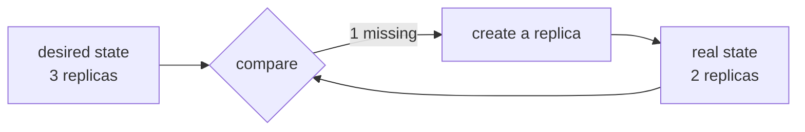

## What is left to solve

Suppose you got this far: the application is packaged, state lives outside, there are several instances and a balancer in front. There is still work a person does:

- Deciding which machine each copy runs on, and redoing it when you add a machine.
- Bringing back an instance that died, elsewhere if its server went down.
- During a deployment, pulling out of rotation, updating, waiting for it to answer, putting it back — instance by instance.
- Rebalancing load when one machine is full and another is empty.
- Delivering secrets and configuration to each copy without baking them into the image.

An **orchestrator** is a program that does all of that. And it does it in a particular way that is the important part.

## Declaring instead of executing

Your deployment script states *steps*: connect, stop this, copy that, start. If it fails halfway, you are left in a state nobody described.

An orchestrator receives a *description of the result*: "I want three replicas of this image, with this memory limit, reachable at this name". It then continuously compares that desired state with the real one and acts to close the gap.

That difference explains the rest. Nobody "restarts" a dead container: it is declared that three must exist, and the loop notices there are two. A deployment is not a script, it is changing the declared image and letting the loop replace the replicas at the pace you asked for.

## The options, by what they cost

| Option | What it saves you | What it charges you |
| --- | --- | --- |
| **Docker Compose** on one machine | Bringing several containers up together | Spreads across no machines and heals nothing |
| **Docker Swarm** | Several machines, replicas, rolling, secrets | Thin community and development |
| **Nomad** | Orchestrates containers and plain processes alike | Smaller ecosystem |
| **Managed Kubernetes** (EKS, GKE, AKS) | All of the above plus an enormous ecosystem | Real conceptual complexity, and a control-plane bill |
| **Container platforms** (Cloud Run, ECS Fargate, Fly.io) | Almost all the operations | Less control and provider lock-in |

Kubernetes is the de facto standard, which is why it is the answer you always hear. It is also the one that introduces the most new concepts at once: pods, services, ingress, ConfigMaps, and a network of its own. Learning it is not the problem. Operating it the night a node runs out of memory and you do not know which of those layers is lying, is.

:::caution[An orchestrator's cost is not learning it]
Almost anyone can stand up a cluster in an afternoon by following a guide. The bill arrives the day something breaks and you have to tell whether the problem is the pod, the node, the ingress, the certificate, the internal DNS or the network policy. That knowledge cannot be improvised during an outage.
:::

## When it does not pay off yet

Fairly reliable signals that the answer is "not yet":

- You have one single service. An orchestrator coordinates many pieces; with one, it coordinates nothing.
- Your application still holds state in memory. Without interchangeable instances there is nothing to spread, and the orchestrator will only make the problem harder to see.
- Nobody on the team has operated one before. The first real incident will arrive before the experience does.
- Your traffic fits comfortably on one mid-sized machine.

And signals that it does pay off: several services deployed separately, several teams that need to stay out of each other's way, or a load so variable that sizing by hand is guessing.

Between the two there is a middle ground that gets mentioned rarely: a **managed container platform**. You hand it the image and it returns a URL with TLS, scaling and gradual rollout, with no cluster to operate. For most projects that "need Kubernetes", this is what they actually needed.

## Check your understanding

What is the difference between a deployment script and an orchestrator?

The script runs steps and finishes; if it fails halfway, it leaves a state nobody described. The orchestrator holds a description of the desired result and continuously compares it with the real one, acting to close the gap. That is why it recovers from a crash on its own: nobody asked it to restart anything, they asked for three replicas to exist.

Your application keeps sessions in memory. What happens if you put it on Kubernetes?

The same intermittent failures you would get with any balancer, and harder to see: the orchestrator moves and recreates pods on its own, so sessions vanish at moments that correlate with no deployment at all. Moving state out is a prerequisite, not a later improvement.

One service, steady traffic, a team of three. Kubernetes?

No. There is nothing to coordinate and a lot of new surface to operate. One or two machines with Compose behind a proxy, or a managed container platform, cover that case at a fraction of the operational cost. Kubernetes starts paying off with several services, several teams, or a load that is hard to size.

## Keep exploring

- [Kubernetes · concepts](https://kubernetes.io/docs/concepts/) — the declarative model and its objects, at the source.
- [Docker Swarm · swarm mode](https://docs.docker.com/engine/swarm/) — the small option, with syntax you already know.
- [Google Cloud Run](https://cloud.google.com/run/docs) — an example of a platform that takes an image and returns a URL.
