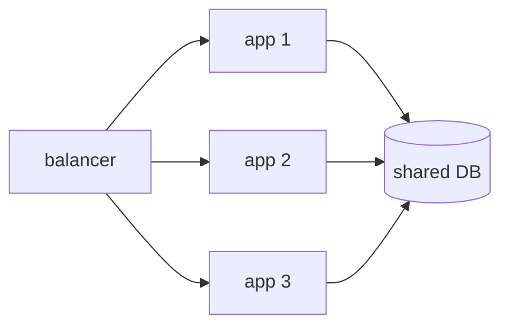

## First: is it capacity or efficiency?

The question to answer before touching anything is whether the system lacks machine or has too much work. From outside they look alike — the site is slow — and they have opposite answers.

| What you see | Usually efficiency | Usually capacity |
| --- | --- | --- |
| High latency with little traffic | Yes | No |
| Latency that grows with traffic and settles when it drops | No | Yes |
| One slow route and the rest fine | Yes | No |
| CPU at 30% and slow responses | Yes | No |
| CPU pinned at 95% | No | Yes |

A query with no index, a call inside a loop, an 8 MB image served uncompressed: none of that improves with twice the server, and it costs twice as much.

:::caution[Scaling can hide the problem]
Doubling the machine can make the symptom disappear for a few weeks. The problem is still there, with double the bill. Measure first.
:::

## Find the resource that ran out

"The server is saturated" is not a diagnosis. One specific resource saturates, and each looks different:

```bash
uptime                  # load average: processes waiting for CPU
free -h                 # free memory and, above all, swap in use
df -h                   # disk space per filesystem
iostat -x 5             # disk %util: at 100%, that is the limit
ss -s                   # open and waiting connections
```

Two readings that get misinterpreted often:

- **High "used" memory is not a problem.** Linux uses free RAM as disk cache and gives it back when somebody needs it. What matters is *swap* in use: if the system is writing memory to disk, every access just became thousands of times slower.
- **High load average with low CPU** means processes are waiting for something else, usually disk or network. Adding CPU would change nothing.

In a web application it is worth looking at the database too, which is not on that list. One slow query holds a connection, connections run out, and the whole application looks saturated even with its CPU at 20%.

## Vertical: the same machine, bigger

Swap the instance for one with more CPU and more RAM. In a cloud that is a reboot and a change of bill.

- **For:** it changes nothing in the code or the architecture. It is reversible. You can have it within the hour.
- **Against:** there is a ceiling, it is priced in large steps, and it means an outage. And you still have one single point of failure: that machine goes down and there is no service.

While there is headroom it is the simplest option, and an 8-core, 32 GB VPS leaves a fair amount of it.

## Horizontal: more identical machines

Run several copies of the application and spread traffic across them. It has no practical ceiling and survives one instance going down.

The cost is not the extra machine: it is that **this stops being a change of size and becomes a change of architecture**. From here on your application has to meet conditions nobody used to ask of it:

- Keep no state in its memory: no sessions, no local cache, no uploaded files.
- Tolerate two instances doing the same thing at once, scheduled jobs included.
- Share the database and the storage, which become the common point of failure.



Look at the diagram: you just multiplied the application and **not** the database. If the limit was there, scaling horizontally makes it worse, because now three times as many clients are asking it for connections.

## The order that tends to work

1. **Measure** and find the specific resource that ran out.
2. **Fix the obvious**: the missing index, the query in a loop, the uncompressed asset.
3. **Scale vertically** while there is ceiling left and the price is reasonable.
4. **Move state out** of the application, which is the real work that enables what follows.
5. **Scale horizontally**, now with interchangeable instances.

Skipping 4 and doing 5 produces a system that fails intermittently and is hard to reproduce: some requests hit the instance holding your session and some do not.

## Check your understanding

<details>
<summary>CPU sits at 25% and responses take three seconds. Do you scale?</summary>

No. With the CPU idle, the time goes on waiting for something: disk, network, or — most likely — the database. More CPU does not shorten a wait. Find the slow query or the external call before touching the size of the machine.

</details>

<details>
<summary>You go from one instance to three and some users lose their session at random. What is missing?</summary>

The session lives in each instance's memory, so it only works while the balancer happens to hit the same one. It has to move outside — to Redis or the database — so all three instances see the same thing. That is the step that makes the copies interchangeable.

</details>

<details>
<summary>Why can scaling horizontally make a database bottleneck worse?</summary>

Because you multiply the clients without multiplying the server serving them. Three instances open three times as many connections and fire three times as many queries at the same database, which was already the limit. The database has to be relieved first — indexes, cache, read replicas — or the spreading only speeds up the pile-up.

</details>

## Keep exploring

- [Brendan Gregg · USE method](https://www.brendangregg.com/usemethod.html) — utilisation, saturation and errors, resource by resource.
- [The Twelve-Factor App · concurrency](https://12factor.net/concurrency) — scaling out via the process model, and what it demands of the application.
