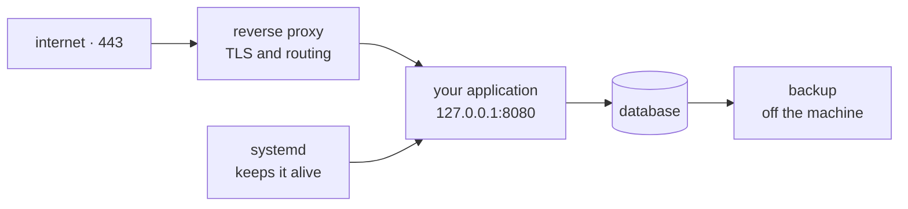

**Where you are:** until now the code lived on your machine and in a repository. Here it leaves for the first time: someone else's machine, a public IP, and users who can reach it.

## What it takes to answer one request

It is tempting to think deploying means copying files to a server. It does not. Between the code and an answered request there are four pieces, and each solves a different problem:

- The **proxy** solves that only one process can hold port 443, and concentrates the certificate.
- The **supervisor** solves that a hand-started process dies with your session and does not return after a reboot.
- The **firewall** solves that a public IP starts receiving automated login attempts within hours of existing.
- The **backup** solves that a single disk is a single copy of the data.

Remove any of the four and the system keeps working — until the day it does not.

## Why start here and not with containers

You can deploy with Docker having never configured a server by hand. Plenty of people do. The problem arrives when something breaks: a container that will not start, a port that does not answer, an expired certificate. Without having seen those pieces separately, all of it looks like "Docker is not working".

This module separates them. Afterwards a container stops being magic and becomes what it is: a way to package the application and its dependencies, which saves you neither the proxy, nor the certificate, nor the backup.

## The route

| Moment | Question | Page |
| --- | --- | --- |
| Access | How do I get in without leaving the door open? | [Provisioning a VPS](/en/server/provisioning/) |
| Startup | How does the code arrive and with what configuration does it run? | [Deploying by hand](/en/server/manual-deploy/) |
| Persistence | What keeps it alive when I close the terminal? | [Keeping the application alive](/en/server/processes/) |
| Entry | How does traffic arrive and where does the HTTPS come from? | [Reverse proxy and certificates](/en/server/proxy-tls/) |
| Data | What happens if this disk disappears? | [Backups](/en/server/backups/) |
| Practice | Can I walk the whole path? | [Practice · from empty VPS to HTTPS](/en/server/lab-vps-deploy/) |

:::note[A VPS is still a serious option]
Kubernetes and managed platforms existing does not make a single server a mistake. For most projects it is cheaper, easier to diagnose, and sufficient for far longer than people assume. What you need to know is when it stops being so.
:::

## What you can do with this

These pages let you take a freshly created VPS and leave it serving an application over HTTPS, surviving a reboot, with the ports closed and a backup that leaves the machine.

## Where this breaks

| Symptom | What causes it | Where it continues |
| --- | --- | --- |
| The new server does not come out like the previous one | The steps exist in your memory and in no file | [Containers](/en/containers/) |
| You find out the code will not start once it is already on the server | The first check happens in the worst possible place | [Continuous integration](/en/integration/) |
| Every update means SSHing in and repeating the same sequence | The deployment depends on a person being available | [From build to release](/en/deployment/pipeline/) |
| Updating cuts the service for a few seconds | The old version stops before the new one is ready | [Deployment strategies](/en/deployment/strategies/) |
