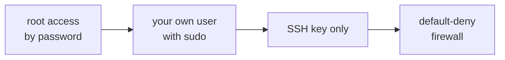

## What you have just been handed

A **VPS** — virtual private server — is a Linux virtual machine with a public IP address and nothing else. No provider — Hetzner, DigitalOcean, EC2 — hands it to you configured: it hands it to you booted, with `root` access and whatever ports the system opened on its own.

That initial state is convenient, but it is not one to keep. Three things change it, in this order.



## Log in with a key, not a password

A password travels to the server every time you use it, and it can be guessed by brute force: a public IP starts receiving automated login attempts within hours of existing.

An **SSH key** is two files generated together. The *public* one is copied to the server and is not secret; the *private* one stays on your machine and never leaves it. When you connect, the server poses a challenge only the private key can answer, so you prove you have it without ever sending it.

```bash
ssh-keygen -t ed25519 -C "you@example.com"   # on YOUR machine, not the server
ssh-copy-id root@203.0.113.10                # copies the public key to the server
ssh root@203.0.113.10                        # this should no longer ask for a password
```

The passphrase `ssh-keygen` asks for encrypts the private key on your disk. Set one: without it, anyone who copies that file gets into every server you own.

## Your own user

`root` can do anything, including the thing you did not mean. A normal user with `sudo` rights does the same work, but it makes you type `sudo` in front of the dangerous parts, and that pause prevents accidents.

```bash
adduser marta                       # creates the user and asks for its password
usermod -aG sudo marta              # lets it escalate when it asks
install -d -m 700 -o marta -g marta /home/marta/.ssh
install -m 600 -o marta -g marta ~/.ssh/authorized_keys /home/marta/.ssh/   # copies your key to that account
```

Check that you can log in as `marta` **from a second terminal, without closing the root session**, before going any further. If something went wrong, the session you already have open is your only way to fix it.

## Closing the back door

With the user working, remove the two ways in you no longer need:

```bash
printf 'PermitRootLogin no\nPasswordAuthentication no\n' \
  | sudo tee /etc/ssh/sshd_config.d/00-atlas.conf
sudo sshd -t && sudo systemctl restart ssh
sudo sshd -T | grep -Ei '^(permitrootlogin|passwordauthentication)'
```

The file goes in `sshd_config.d` rather than `sshd_config` for a specific reason: `sshd` keeps the **first** value it reads for each option, and it reads that folder first, in alphabetical order. Many cloud images ship a file of their own there that enables passwords, so editing the main file would change nothing. `sshd -T` prints the configuration actually being applied: that is the check, not the file you wrote.

From here on, a password attempt is refused without even being tried, and most of those automated attempts stop making sense.

:::caution[Do not close the session until you have checked]
Restart SSH and, without closing the terminal you already have open, log in from another one. If you made a mistake in the configuration file, that live session is the only thing between you and the provider's rescue console.
:::

## Only the ports you use

`ufw` is the friendly layer over the system firewall. The useful rule is always the same: deny everything inbound, allow everything outbound, and open by hand the little that is needed.

```bash
sudo ufw default deny incoming
sudo ufw default allow outgoing
sudo ufw allow OpenSSH        # 22 — or whichever port your SSH listens on
sudo ufw allow 80/tcp         # HTTP, needed to issue certificates
sudo ufw allow 443/tcp        # HTTPS
sudo ufw enable
sudo ufw status verbose
```

Notice what is **not** there: your application's port and the database's. Neither should be reachable from the internet — the proxy reaches them over `127.0.0.1`, which does not go through the firewall.

## Let the system patch itself

Security updates nobody applies protect nothing. On Debian and Ubuntu this takes two commands:

```bash
sudo apt update && sudo apt upgrade -y
sudo apt install unattended-upgrades
```

## Keep exploring

- [SSH · public key authentication](https://www.ssh.com/academy/ssh/public-key-authentication) — how the challenge works underneath.
- [ufw · Ubuntu guide](https://help.ubuntu.com/community/UFW) — the reference for rules and profiles.
- [unattended-upgrades](https://wiki.debian.org/UnattendedUpgrades) — what updates itself and what does not.
