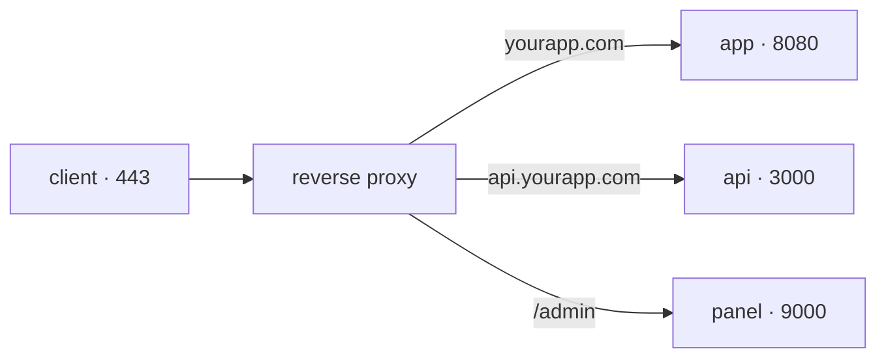

## One single 443 for many services

Your server has one IP and an application listening on port 8080. A user's browser knows nothing about that port: it asks for `https://yourapp.com`, which means port 443. And tomorrow you want to host a second application there, and an API, and the admin panel.

They cannot all listen on 443: one port belongs to one process. Something has to sit in front, receive all the traffic, and decide where each request goes.



That is a **reverse proxy**: a server that receives requests on behalf of your services and forwards each one to whichever it belongs to. It is called "reverse" because an ordinary proxy represents the client to the internet; this one represents the server to the client, who never learns what is behind it.

## What it gives you

Routing is only the first reason. A reverse proxy concentrates in one place four things you would otherwise solve inside every application:

- **TLS.** The certificate is installed and renewed in a single place. The proxy decrypts the connection and talks to your services over the internal network. This is called *TLS termination*.
- **Minimal surface.** Your services stop publishing ports to the outside: only the proxy is reachable from the internet, and the rest listen on `127.0.0.1`, where nobody outside arrives.
- **Common rules.** Size and rate limits, security headers, compression, timeouts: written once, applying to everything behind.
- **One access log.** Every request passes through the same place, so there is a single place to see what is coming in.

```nginx
server {
  listen 443 ssl;
  server_name yourapp.com;
  ssl_certificate     /etc/letsencrypt/live/yourapp.com/fullchain.pem;
  ssl_certificate_key /etc/letsencrypt/live/yourapp.com/privkey.pem;

  location / {
    proxy_pass http://127.0.0.1:8080;   # the service only listens locally
    proxy_set_header Host $host;
    proxy_set_header X-Forwarded-For $remote_addr;
    proxy_set_header X-Forwarded-Proto $scheme;
  }
}
```

You do not write the two `ssl_certificate` lines yourself: Certbot adds them when it issues the certificate, as you will see below. Without them nginx rejects the block.

The headers matter more than they look: without them your application believes every request comes from the proxy rather than the user, the logs stop being useful for investigating anything, and any redirect it builds will come out as `http://` even though the user arrived over HTTPS.

## Where the certificate comes from

A certificate is proof that the domain is yours. A **certificate authority** issues it after checking, and browsers only trust the authorities already on their list.

Let's Encrypt issues for free and automatically through the **ACME** protocol: you request a certificate for `yourapp.com`, the authority sets you a challenge — usually publishing a file under `http://yourapp.com/.well-known/acme-challenge/` — and solving it proves you control that domain. Certbot handles both halves for you.

```bash
sudo apt install certbot python3-certbot-nginx
sudo certbot --nginx -d yourapp.com -d www.yourapp.com
```

Certbot edits your nginx configuration to add the TLS block and the redirect from 80 to 443, and leaves a timer installed that renews before expiry.

```bash
systemctl list-timers | grep certbot     # is the renewal scheduled?
sudo certbot renew --dry-run             # a rehearsal, requesting nothing real
```

:::caution[Renewal is what fails, not issuance]
A Let's Encrypt certificate lasts 90 days. Issuing it by hand once works; remembering every three months does not. Check the timer the same day you issue it, because the failure shows up ninety days later and as a total outage: the browser does not show the site, it shows a warning.
:::

:::note[Caddy, Traefik, nginx: the same role]
The syntax differs, and so does how much is automated — Caddy requests and renews certificates on its own, without Certbot; Traefik configures itself by reading container labels — but all three occupy the same spot in the diagram. Choose by how each one is operated rather than by performance.
:::

## Keep exploring

- [nginx · reverse proxy guide](https://docs.nginx.com/nginx/admin-guide/web-server/reverse-proxy/) — the configuration in its canonical form.
- [Let's Encrypt · how it works](https://letsencrypt.org/how-it-works/) — the ACME protocol and the challenge types.
- [Caddy · reverse_proxy](https://caddyserver.com/docs/caddyfile/directives/reverse_proxy) — the same role with automatic certificates.
