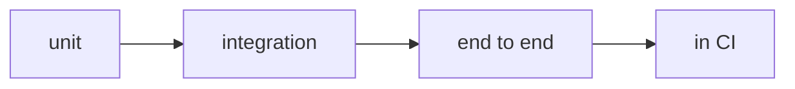

**Where you are:** In Foundations you learned to observe; in Collaboration, to review; in Delivery, to package. Testing closes the loop: it turns "I think it works" into "I can prove it works".

## Testing is asserting with evidence

An automated test is an executable assertion: given some input, the system responds in a certain way. When it fails, you do not argue opinions; you read concrete, reproducible evidence.

If you already code, none of that is new. What changes in DevOps is where the suite lives: it stops being a check you run when you remember and becomes a **gate on the delivery path**. It runs by itself on every change, in a clean environment that is not yours, and its result decides whether the artifact goes any further. A test stops being your personal insurance and becomes shared evidence.

## The route

| Moment | Question | Page |
| --- | --- | --- |
| Pyramid | What to test and at which level? | [The testing pyramid](./pyramid/) |
| Automation | How do tests run on every change? | [Tests in CI](./in-ci/) |
| Practice | Can I write and run a test? | [Practice · your first test](./lab-first-test/) |

:::note[A test that never fails protects nothing]
If a test always passes, even when you break the code, it is not testing what you think. A good test fails when the behaviour changes.
:::

## Expected outcome

You will be able to distinguish test levels, decide what to automate in CI, and write a first test that fails for the right reason.
