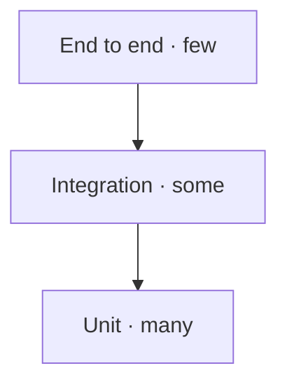

## Three levels, three questions



- **Unit**: tests a function or module in isolation. Fast, precise, cheap. Answers: does this piece do what I say?
- **Integration**: tests that several pieces cooperate (for example, code plus a database). Answers: do they fit together?
- **End to end (E2E)**: tests the system the way a person uses it. Slow and valuable. Answers: does the whole route work?

The pyramid shape is not decorative: you want **many** unit tests (fast) and **few** E2E tests (slow). Inverting the pyramid —mostly E2E— produces slow, flaky suites.

## What makes a test good

- **Deterministic**: same input, same result, without depending on the time or the network.
- **Isolated**: it does not depend on order or on another test.
- **Readable**: its name says which behaviour it protects.

```js
// a unit test: the name describes the expected behaviour
test('sum ignores null values', () => {
  expect(sum([1, null, 2])).toBe(3);
});
```

## Flaky tests: the hidden cost

A **flaky** test fails for reasons unrelated to behaviour: a timeout, a changed selector, a random value. Each false failure erodes trust until the team ignores the suite, and then it protects nothing. Prefer a few reliable tests over many noisy ones.

:::caution Do not test the implementation, test the behaviour
A test tied to internal details breaks on every refactor, even when behaviour does not change. Assert what the system does, not how it does it.
:::

## Check your understanding

<details>
<summary>Your E2E suite takes 40 minutes and fails at random. What rebalancing do you propose?</summary>

Move most checks down to unit and integration tests (fast and deterministic) and keep only a few E2E for the critical routes. The pyramid stands on many fast tests, not on many slow ones.

</details>

<details>
<summary>A test breaks every time you rename an internal variable. What is wrong?</summary>

It is testing the implementation, not the behaviour. Rewrite it to assert the observable result (inputs and outputs), so a refactor that does not change behaviour does not break it.

</details>

## Keep exploring

- [The Practical Test Pyramid (Martin Fowler)](https://martinfowler.com/articles/practical-test-pyramid.html) — the reference article.
- [Google Testing Blog](https://testing.googleblog.com/) — testing practices at scale.
