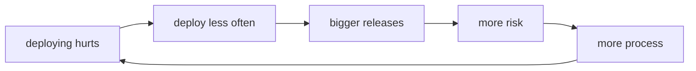
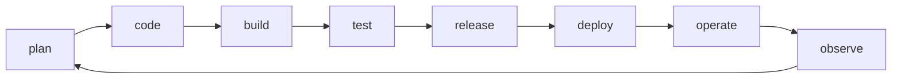

## It starts with a wall

For years, building software and operating it were two separate jobs with opposing incentives:

- **Development** exists to change the system. It is measured by features delivered.
- **Operations** exists to keep it standing. It is measured by stability.

Every change one side ships is a risk the other absorbs. A wall grows between them, and releases get thrown over it: here is the code, make it run.

That wall feeds itself. If deploying hurts, you deploy less often. If you deploy rarely, each release piles up more changes. The bigger the release, the riskier. The riskier it is, the more process gets added. And the more process, the less often anyone deploys.

When something breaks in production, nobody holds the whole system in their head: whoever wrote it never sees it run, and whoever sees it run never wrote it.

## So what is DevOps

**DevOps is a way of working in which the people who build a system also answer for how it behaves in production, and in which every step between a commit and a user is automated, observable, and reversible.**

It is not a technology. It is the decision to treat "building" and "operating" as one job, plus the practices and tools that make that decision sustainable: if a team is going to answer for its own system in production, shipping has to be cheap, state has to be visible, and going back has to be fast.

Everything else follows from that. The tools you will meet in this Atlas — Git, Docker, CI/CD — exist to lower the cost of that cycle, not the other way around.

:::note[DevOps does not install]
No tool turns a team into a DevOps team. Automating a broken handoff only makes the handoff fail faster.
:::

## What it is not

- **Not a separate team.** A "DevOps team" placed between development and operations is the old wall with a new name: there is still a handoff, and someone still absorbs risk they did not create.
- **Not just automation.** Automation is the means. The end is shortening the cycle between an idea and the evidence that it works.
- **Not "the pipeline person".** The pipeline is a visible consequence of the practice, not its definition.
- **Not a replacement for development.** It assumes you already know how to build software; it adds the half almost no degree teaches.

## The full cycle

A software change always travels the same cycle, and the point is that **it is a cycle**: what you learn operating the system feeds back into planning.

| Stage | Question it answers |
| --- | --- |
| Plan | What are we changing, and why? |
| Code | How do we write it, and how do several people review it? |
| Build | How does source become something installable? |
| Test | How do we show it does what it claims? |
| Release | Which exact version becomes available to deploy? |
| Deploy | How does it reach production without taking the service down? |
| Operate | Who answers when it breaks, and with what emergency exit? |
| Observe | What is actually happening in there? |

If you come from development, you already live the left half of the cycle. In practice, DevOps means taking on the right half — and above all the arrow that closes the loop.

## Three ideas that hold up the rest

Almost everything in this Atlas rests on three ideas. When a recommendation looks arbitrary, it usually reduces to one of them.

**1 · Flow: small and frequent is safer than big and rare.**
It sounds backwards, since deploying more often looks like more chances to fail. But a small change actually gets reviewed, is understood end to end, and when it breaks you know what caused it: only one thing changed. Ten changes failing together are ten suspects.

**2 · Feedback: the useful kind arrives early.**
A mistake caught while writing costs minutes; the same mistake caught in production costs an incident. That is why checks run cheapest-first, and why it matters that a failure points at its cause instead of saying "failed".

**3 · Reversibility: being able to go back beats never failing.**
No system stops failing. The difference between a calm team and one that prays before deploying is not the number of errors — it is how long they take to undo them.

## What the job actually looks like

Day to day varies a lot by company, but the work usually mixes:

- Building and maintaining the automatic path from commit to production.
- Packaging applications so they run the same on any machine.
- Defining and versioning infrastructure instead of configuring it by hand.
- Operating environments: deploys, versions, configuration, secrets, permissions.
- Investigating failures with evidence instead of guesses.
- Deciding how something deploys and how it rolls back, before you need it.
- Measuring the system so you know it is healthy without waiting for a complaint.

Job titles differ — DevOps engineer, platform engineer, SRE — and each stresses a different point, but the underlying problems are the same.

## Where each module fits

This Atlas takes you from reading a machine to shipping a version and being able to roll it back. Each module handles one stretch of the cycle:

| Stage of the cycle | Where it is covered |
| --- | --- |
| Reading a machine and a network | [01 · Foundations](/en/foundations/) |
| Coding and reviewing as a team | [02 · Collaboration](/en/collaboration/) |
| Building, packaging, automating | [03 · Delivery](/en/delivery/) |
| Testing with evidence | [04 · Testing](/en/testing/) |
| Releasing, deploying, rolling back | [05 · Deployment](/en/deployment/) |

**What you will not find here yet:** infrastructure as code, public clouds, Kubernetes, observability (metrics, logs, traces), and security. When a page needs to lean on one of those topics, it says so and links you to an outside source.

:::caution[Prerequisite]
This Atlas assumes you already code: that you can write code, use an editor, and read an error. It does not teach programming from zero.
:::

## Finding what you came for

- **Starting from scratch?** Read in order: modules run 01 to 05 and each leans on the previous one.
- **Here for one specific thing?** Use search or the [A–Z tools index](/en/tools/) and go straight to the page.

Every page states which module it belongs to and what is worth knowing first, so you can come in halfway through without missing the context.

All the content exists in Spanish and English: switch language whenever you like and stay on the same page.

## Check your understanding

A company creates a "DevOps team" between development and operations. Which problem comes back?

The wall. There is still a handoff, and there is still a team absorbing the risk of changes someone else wrote. The boundary just moved: now there are two handoffs instead of one.

If every deploy can fail, why does deploying more often reduce risk?

Because the risk is not in the number of deploys but in the size of each one. A small deploy changes one thing: it is easy to review, its failure has a single suspect, and reverting it returns the system to a known state. Batching changes does not prevent the failure — it only makes it harder to diagnose.

## Keep exploring

- [DORA · State of DevOps](https://dora.dev/) — the research that measured which practices correlate with fast, stable teams.
- [Google SRE Book](https://sre.google/sre-book/table-of-contents/) — how a system is operated for real (free online).
- [The Twelve-Factor App](https://12factor.net/) — a compact set of decisions that make an application operable.
