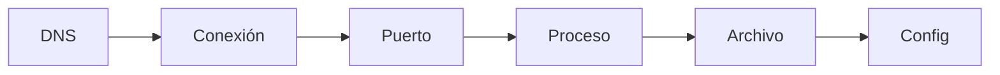

:::tip[¿Primera vez aquí?]
Si todavía no tienes claro qué es DevOps ni qué parte del ciclo cubre este Atlas, empieza por [Qué es DevOps](/what-is-devops/) y vuelve aquí.
:::

**Dónde estás:** el punto de partida. Todo lo que viene después —Git, Docker, CI, despliegues— da por supuesto que puedes mirar una máquina y decir qué está pasando en ella.

## La primera habilidad: observar

Antes que cualquier herramienta está la capacidad de hacer preguntas concretas sobre un sistema: qué proceso escucha, qué archivo cambió, por qué una petición no llega y qué evidencia respalda una decisión.

Este módulo reúne el mapa mínimo para moverse por Linux y una red: pocos comandos, encadenados en observaciones pequeñas y verificables.

## Recorre el sistema de afuera hacia adentro

Cuando algo falla, sigue siempre el mismo orden. Cada parada descarta una parte del problema antes de tocar la siguiente:

## El recorrido

| Momento | Pregunta | Página |
| --- | --- | --- |
| Sistema | ¿Dónde vive la configuración y quién puede tocarla? | [Linux](/foundations/linux/) |
| Proceso | ¿Qué se está ejecutando y quién lo inició? | [La terminal](/foundations/terminal/#observar-procesos) |
| Red | ¿La aplicación escucha y puede ser alcanzada? | [Redes esenciales](/foundations/networking/) |
| Práctica | ¿Puedo reproducir una investigación? | [Práctica · investigar una aplicación local](/foundations/lab-shell-and-network/) |

:::tip[Cambia el orden de tus preguntas]
Recorrer el sistema de afuera hacia adentro —DNS → conexión → puerto → proceso → archivo → configuración— reduce la tentación de cambiar cinco cosas a la vez.
:::

## Qué cubre

Estas páginas cubren el recorrido de una petición, cómo encontrar un proceso y cómo verificar una conexión con herramientas locales. Ese vocabulario es la base de Git, Docker y CI/CD.

## Dónde se rompe esto

| Síntoma | Qué lo causa | Dónde sigue |
| --- | --- | --- |
| Dos personas cambian el mismo archivo y una pisa el trabajo de la otra | No hay historial ni forma de proponer un cambio antes de aplicarlo | [Colaboración](/collaboration/) |
| La aplicación arranca en tu máquina y no en otra | Cada máquina tiene instalado algo distinto y nadie fijó la lista | [Contenedores](/containers/) |
| Descubres que algo no compila cuando ya está en el servidor | La primera comprobación ocurre demasiado tarde y en el peor sitio | [Integración continua](/integration/) |
