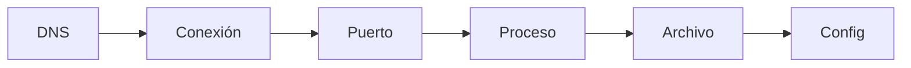

:::tip[¿Primera vez aquí?]
Si todavía no tienes claro qué es DevOps ni qué parte del ciclo cubre este Atlas, empieza por [Qué es DevOps](/what-is-devops/) y vuelve aquí.
:::

**Dónde estás:** el punto de partida. Todo lo que viene después —Git, Docker, CI, despliegues— da por supuesto que puedes mirar una máquina y decir qué está pasando en ella.

## La primera habilidad: observar

DevOps no empieza con una herramienta, sino con la capacidad de hacer preguntas concretas sobre un sistema: qué proceso escucha, qué archivo cambió, por qué una petición no llega y qué evidencia respalda una decisión.

En este módulo construyes el mapa mínimo para moverte por Linux y una red. No necesitas memorizar cientos de comandos; necesitas encadenar observaciones pequeñas y verificables.

## Recorre el sistema de afuera hacia adentro

Cuando algo falla, sigue siempre el mismo orden. Cada parada descarta una parte del problema antes de tocar la siguiente:

## El mapa de fundamentos

| Señal | Pregunta útil | Página |
| --- | --- | --- |
| Sistema | ¿Dónde vive la configuración y quién puede tocarla? | [Linux](./linux/) |
| Proceso | ¿Qué se está ejecutando y quién lo inició? | [La terminal](./terminal/#observar-procesos) |
| Red | ¿La aplicación escucha y puede ser alcanzada? | [Redes esenciales](./networking/) |
| Práctica | ¿Puedo reproducir una investigación? | [Práctica · shell y red](./lab-shell-and-network/) |

:::tip[Cambia el orden de tus preguntas]
Recorrer el sistema de afuera hacia adentro —DNS → conexión → puerto → proceso → archivo → configuración— reduce la tentación de cambiar cinco cosas a la vez.
:::

## Qué puedes hacer con esto

Con estas páginas puedes describir el recorrido de una petición, encontrar un proceso y verificar una conexión con herramientas locales. Ese vocabulario es la base de Git, Docker y CI/CD.
