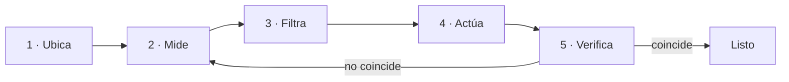

## La terminal no es magia

Una shell es un intérprete: recibe texto, ejecuta programas y conecta sus entradas y salidas. Su valor no está en parecer críptica, sino en que cada paso puede convertirse en una instrucción repetible —algo que puedes guardar, revisar y automatizar más tarde.

Cada programa nace con tres canales: **entrada** (`stdin`), **salida** (`stdout`) y **errores** (`stderr`). Separarlos te permite guardar un resultado sin mezclarlo con los avisos.

```bash
pwd                            # ¿dónde estoy?
ls -la                         # ¿qué hay aquí, incluido lo oculto?
printf 'hola\n' > saludo.txt   # redirige stdout a un archivo
```

La salida también es una interfaz. Antes de ejecutar un comando destructivo, mira dónde estás, qué archivos selecciona y qué permisos tiene tu usuario.

## Leer archivos y permisos

`ls -l` no es decoración: cada columna responde una pregunta operacional.

```bash
ls -l servidor.log
# -rw-r--r-- 1 deploy web 2048 jul 22 09:14 servidor.log
```

De izquierda a derecha: tipo y **permisos** (`rw-` para el dueño, `r--` para el grupo, `r--` para el resto), número de enlaces, **dueño**, **grupo**, tamaño en bytes, fecha y nombre. Cuando un servicio "no puede escribir su log", casi siempre la respuesta está en esas tres ternas.

```bash
chmod 640 servidor.log        # dueño lee/escribe, grupo lee, resto nada
chown deploy:web servidor.log # cambia dueño y grupo
```

Cambia permisos con intención, no por reflejo: `640` dice algo preciso sobre quién puede hacer qué.

## Composición con tuberías

El carácter `|` conecta la salida de un proceso con la entrada del siguiente. Una investigación útil suele ser una composición pequeña y legible:

```bash
ps aux | grep '[n]ginx'        # ¿corre nginx? ¿con qué PID?
find . -name '*.log' | wc -l   # ¿cuántos logs hay bajo este árbol?
```

El patrón `[n]ginx` evita que el propio `grep` aparezca en la lista: los corchetes forman una clase que coincide con la letra `n`, pero el texto literal `[n]ginx` ya no está en esa línea. No es un truco para copiar; expresa exactamente qué buscas.

## Procesos y servicios

Un proceso es una instancia viva de un programa: tiene un PID, un usuario, un estado y, normalmente, archivos o sockets abiertos.

```bash
ps -ef            # todos los procesos del sistema
ss -lntup         # ¿qué escucha, en qué puerto y quién?
```

`ss` responde una pregunta muy concreta: ¿hay algo escuchando en el puerto que espero? En Linux moderno, muchos programas se ejecutan como **servicios** gestionados por `systemd`:

```bash
systemctl status nginx       # ¿está activo? ¿desde cuándo?
journalctl -u nginx -n 50    # sus últimas 50 líneas de log
```

:::caution No uses permisos elevados por reflejo
`sudo` amplía el radio de impacto de un comando. Primero intenta leer; eleva permisos únicamente cuando el sistema te lo pida y entiendas qué cambiará.
:::

## Modelo mental: el bucle de diagnóstico

Piensa en la terminal como una cámara de diagnóstico. Cada intervención sigue el mismo bucle, y solo actúas **después** de medir:



1. **Ubica** el contexto (`pwd`, `whoami`, `env`).
2. **Mide** el estado (`ps`, `free`, `df`, `ss`).
3. **Filtra** la evidencia (`grep`, `awk`, `sort`).
4. **Actúa** con el cambio mínimo.
5. **Verifica** que el estado final coincide con tu intención; si no, vuelve a medir.

## Comprueba lo que entendiste

<details>
<summary>¿Por qué se usa el patrón [n]ginx en lugar de nginx?</summary>

Porque `grep 'nginx'` también encontraría su propio proceso en la salida de `ps`. Los corchetes `[n]` forman una clase de caracteres que coincide con la letra `n`, pero el texto literal `[n]ginx` ya no aparece en la línea del propio `grep`, así que se excluye a sí mismo del resultado.

</details>

<details>
<summary>Un servicio no puede escribir en /var/log/app.log. ¿Qué miras primero?</summary>

`ls -l /var/log/app.log`, para leer dueño y permisos. Si el proceso corre como el usuario `app` pero el archivo pertenece a `root` sin permiso de escritura para el grupo, esa es la causa —y se resuelve con `chown`/`chmod`, sin tocar el código.

</details>

## Sigue explorando

- `man` es tu primera parada: prueba `man ss` o `man chmod`. La sección de ejemplos suele bastar.
- [Linux Journey](https://linuxjourney.com/) — un recorrido guiado y gratuito por la línea de comandos.
- [ExplainShell](https://explainshell.com/) — pega un comando y te explica cada parte.
