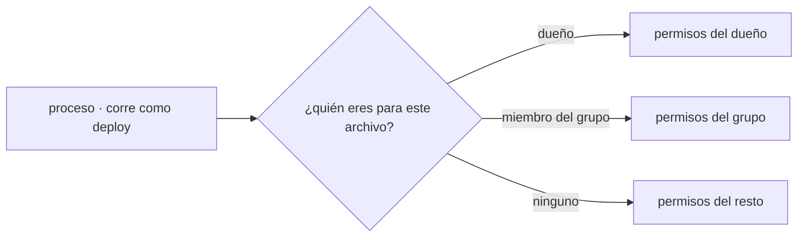

## Por qué Linux y no otro sistema

Puedes desarrollar en Windows o en macOS sin problema. Pero cuando ese código se va a ejecutar de verdad, casi siempre aterriza en Linux:

- **Los servidores.** La enorme mayoría de los servidores web y de las máquinas virtuales que alquilas en una nube arrancan una imagen de Linux.
- **Los contenedores.** Una imagen de Docker es, por dentro, un sistema de archivos de Linux. Cuando ejecutas `docker run` en tu Mac, hay una máquina virtual Linux debajo.
- **La automatización.** Los runners donde corre tu CI son, por defecto, Linux.

No es solo cuota de mercado. Linux se diseñó para administrarse **sin pantalla**: un sistema multiusuario que se opera por texto, a distancia, sobre una conexión SSH. Eso tiene una consecuencia directa para lo que haces todos los días: si el estado del sistema se configura con archivos de texto y se cambia con comandos, entonces se puede versionar, revisar y automatizar. Un sistema que solo se administra con clics no te deja hacer nada de eso.

:::note[Unix no es Linux]
macOS también es un Unix y comparte muchos comandos, pero no es Linux: no tiene `systemd`, no trae `ss`, y varias banderas cambian porque sus herramientas son de la familia BSD. Sirve para practicar lo básico, no para asumir que lo que funciona ahí funcionará en el servidor.
:::

## Qué es una distribución

Linux, en sentido estricto, es solo el **núcleo**: la pieza que habla con el hardware y reparte CPU, memoria y disco entre los procesos. Una **distribución** es ese núcleo empaquetado con todo lo demás —programas base, gestor de paquetes, política de versiones y actualizaciones— para formar un sistema utilizable.

Lo que cambia entre distribuciones es sobre todo cómo se instala y se actualiza el software. El modelo del sistema —procesos, permisos, archivos— es el mismo.

| Familia | Gestor de paquetes | Dónde la verás |
| --- | --- | --- |
| Debian · Ubuntu | `apt` | La opción por defecto en la mayoría de servidores y tutoriales |
| RHEL · Fedora · Rocky | `dnf` | Entornos corporativos con soporte de larga duración |
| Alpine | `apk` | Imágenes de contenedor, por su tamaño mínimo |

```bash
apt update                  # refresca la lista de paquetes disponibles
apt install -y nginx        # instala desde el repositorio de la distribución
apt list --installed | head # qué hay instalado y en qué versión
```

Instalar desde el repositorio, y no descargando un binario suelto de internet, es lo que hace que una máquina se pueda reconstruir igual mañana. Esa idea vuelve, más adelante, convertida en imágenes de contenedor.

## Cómo conseguir un Linux para practicar

No necesitas dedicar una máquina. De más simple a más parecido a producción:

- **Un contenedor**, si ya tienes Docker: `docker run -it --rm debian bash` te deja dentro de un Debian en segundos.
- **WSL 2**, si usas Windows: instala Ubuntu con `wsl --install` y tendrás un Linux real integrado en el sistema.
- **Una máquina virtual** (UTM, VirtualBox, Multipass): más pesada, pero se parece a un servidor completo, con arranque y servicios.
- **Un VPS**: una máquina real alquilada por poco dinero, a la que entras por SSH. Es lo más cercano a operar en serio.

Cualquiera de las cuatro sirve para todo lo que viene en este módulo.

## El árbol de archivos

En Linux no hay unidades `C:` ni `D:`. Hay **una sola raíz**, `/`, y todo cuelga de ahí, incluidos los discos que conectes después. Cuando investigues un problema, esta tabla te dice dónde mirar:

| Ruta | Qué contiene | Por qué te importa |
| --- | --- | --- |
| `/etc` | Configuración del sistema y de los servicios | Aquí vive el archivo que probablemente tengas que cambiar |
| `/var/log` | Logs | La primera evidencia cuando algo falla |
| `/var/lib` | Datos que los servicios necesitan conservar | Lo que no puedes perder al reinstalar |
| `/home/usuario` | Archivos personales de cada usuario | Tu espacio, sin permisos especiales |
| `/usr/bin` | Programas instalados | Dónde acaba lo que instalas con el gestor de paquetes |
| `/tmp` | Temporales | Puede limpiarse automáticamente; nunca guardes ahí algo que importe |
| `/proc`, `/sys` | Vista del núcleo, generada al vuelo | Archivos que no existen en disco: son el estado del sistema |

Con eso ya tienes una hipótesis para casi cualquier fallo: la configuración está en `/etc`, lo que pasó está en `/var/log`, y lo que el servicio guardó está en `/var/lib`.

## Usuarios, grupos y permisos

Aquí está el modelo que explica la mayoría de los "no tengo permiso" que vas a encontrar.

**Todo proceso corre como un usuario.** No solo tú: los servicios también tienen su propio usuario, sin privilegios y sin poder iniciar sesión, para que un fallo en la aplicación no comprometa la máquina entera. Un **grupo** permite que varios usuarios compartan acceso a las mismas cosas.

Cada archivo lleva encima tres datos: un dueño, un grupo y qué puede hacer cada cual.



El sistema resuelve esa pregunta en ese orden y aplica **solo** el primer caso que coincide. Ser miembro del grupo no te suma los permisos del dueño.

```bash
ls -l servidor.log
# -rw-r--r-- 1 deploy web 2048 jul 22 09:14 servidor.log
```

De izquierda a derecha: tipo y **permisos**, número de enlaces, **dueño** (`deploy`), **grupo** (`web`), tamaño, fecha y nombre. Los permisos se leen en tres ternas de `rwx` —leer, escribir, ejecutar— para dueño, grupo y resto: aquí `rw-` para `deploy`, `r--` para el grupo `web`, `r--` para todos los demás.

Cada terna también se escribe como un número: `r=4`, `w=2`, `x=1`, sumados.

```bash
chmod 640 servidor.log        # dueño lee/escribe (6), grupo lee (4), resto nada (0)
chown deploy:web servidor.log # cambia dueño y grupo
```

Cuando un servicio "no puede escribir su log", la respuesta casi siempre está en esas tres ternas: el proceso corre como un usuario que no es el dueño ni está en el grupo.

**`root` es el usuario con privilegios muy amplios sobre el sistema**, y `sudo` sirve para ejecutar un comando como él.

:::caution[No uses permisos elevados por reflejo]
`sudo` amplía el radio de impacto de un comando: un error deja de afectar a tus archivos y pasa a afectar a la máquina. Primero intenta leer; eleva permisos solo cuando el sistema te lo pida y entiendas qué va a cambiar.
:::

## Servicios: lo que el sistema arranca por ti

Una aplicación en producción no se lanza a mano y se deja abierta en una terminal. Se registra como **servicio**, y el sistema puede encargarse de arrancarla al encender la máquina, reiniciarla si su configuración lo indica y recoger su salida en un registro central. En Linux moderno, quien hace eso se llama `systemd`.

```bash
systemctl status nginx    # ¿está activo? ¿desde cuándo? ¿se reinició solo?
systemctl restart nginx   # reinícialo
systemctl enable nginx    # y que arranque también en el próximo encendido
journalctl -u nginx -n 50 # sus últimas 50 líneas de log
```

`systemctl status` responde de una vez tres preguntas que si no tendrías que investigar por separado: si el proceso vive, desde cuándo, y qué dijo antes de morir.

Guarda esta idea, porque vuelve más adelante: un contenedor resuelve el mismo problema con otras piezas —también define qué proceso arranca, qué pasa si se cae y dónde van sus logs.

## Comprueba lo que entendiste

<details>
<summary>Un servicio corre como el usuario `app` y no puede escribir en `/var/lib/datos`. ¿Qué miras primero?</summary>

`ls -ld /var/lib/datos`, para ver dueño, grupo y permisos del directorio. Si pertenece a `root:root` con permisos `755`, el usuario `app` cae en la terna del "resto", que no incluye escritura. Se arregla dando la propiedad al usuario correcto (`chown`) o compartiendo el acceso por grupo, no tocando el código.

</details>

<details>
<summary>Un comando funciona en tu Mac pero falla en el servidor. ¿Por qué puede pasar?</summary>

Porque macOS es Unix pero no Linux: sus herramientas vienen de la familia BSD y algunas banderas cambian o directamente no existen, y falta lo específico de Linux como `ss` o `systemctl`. Si vas a operar sobre Linux, prueba sobre Linux: un contenedor o una máquina virtual bastan.

</details>

## Sigue explorando

- [Linux Journey](https://linuxjourney.com/) — un recorrido guiado y gratuito por el sistema, desde cero.
- [Filesystem Hierarchy Standard](https://refspecs.linuxfoundation.org/FHS_3.0/fhs/index.html) — qué se supone que va en cada directorio.
- `man hier` — la misma jerarquía, explicada dentro de tu propia máquina.
