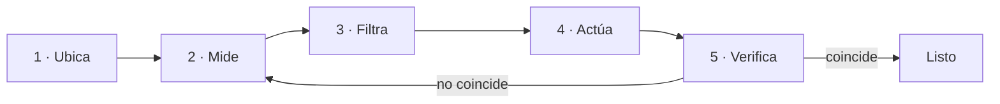

## La terminal no es magia

Una shell es un intérprete: recibe texto, ejecuta programas y conecta sus entradas y salidas. Su valor no está en parecer críptica, sino en que cada paso puede convertirse en una instrucción repetible —algo que puedes guardar, revisar, compartir y automatizar más tarde. Un clic no se puede pegar en un ticket; un comando sí.

Cada programa nace con tres canales: **entrada** (`stdin`), **salida** (`stdout`) y **errores** (`stderr`). Separarlos te permite guardar un resultado sin mezclarlo con los avisos.

```bash
pwd                            # ¿dónde estoy?
ls -la                         # ¿qué hay aquí, incluido lo oculto?
printf 'hola\n' > saludo.txt   # redirige stdout a un archivo
comando 2> errores.txt         # redirige solo stderr
```

La salida también es una interfaz. Antes de ejecutar un comando destructivo, mira dónde estás, qué archivos selecciona y con qué usuario lo estás haciendo. Si necesitas repasar cómo se leen dueño y permisos, están en [Linux](./linux/#usuarios-grupos-y-permisos).

## Composición con tuberías

El carácter `|` conecta la salida de un proceso con la entrada del siguiente. Esa es la idea central de la línea de comandos: en lugar de un programa enorme que lo hace todo, encadenas piezas pequeñas que hacen una cosa.

```bash
ps aux | grep '[n]ginx'        # ¿corre nginx? ¿con qué PID?
find . -name '*.log' | wc -l   # ¿cuántos logs hay bajo este árbol?
journalctl -u nginx | tail -20 # las últimas 20 líneas de su registro
```

El patrón `[n]ginx` evita que el propio `grep` aparezca en la lista: los corchetes forman una clase que coincide con la letra `n`, pero el texto literal `[n]ginx` ya no está en esa línea. No es un truco para copiar; expresa exactamente qué buscas.

## Observar procesos

Un proceso es una instancia viva de un programa: tiene un PID, un usuario, un estado y, normalmente, archivos o sockets abiertos.

```bash
ps -ef            # todos los procesos del sistema
ss -lntup         # ¿qué escucha, en qué puerto y quién?
```

Esos dos comandos responden preguntas distintas. `ps` dice qué se está ejecutando; `ss` dice qué está *accesible*. Un proceso puede estar vivo y no escuchar en ningún puerto, y ahí ya sabes que el problema no es que "la aplicación esté caída".

Cuando el proceso que investigas está gestionado por el sistema, `systemctl status` y `journalctl` te dan lo mismo con más contexto —lo tienes en [Linux · servicios](./linux/#servicios-lo-que-el-sistema-arranca-por-ti).

## Modelo mental: el bucle de diagnóstico

Piensa en la terminal como una cámara de diagnóstico. Cada intervención sigue el mismo bucle, y solo actúas **después** de medir:



1. **Ubica** el contexto (`pwd`, `whoami`, `env`).
2. **Mide** el estado (`ps`, `free`, `df`, `ss`).
3. **Filtra** la evidencia (`grep`, `awk`, `sort`).
4. **Actúa** con el cambio mínimo.
5. **Verifica** que el estado final coincide con tu intención; si no, vuelve a medir.

El paso que más se salta es el segundo, y es el que separa arreglar de adivinar: sin una medición previa no puedes demostrar que tu cambio sirvió de algo.

## Comprueba lo que entendiste

<details>
<summary>¿Por qué se usa el patrón [n]ginx en lugar de nginx?</summary>

Porque `grep 'nginx'` también encontraría su propio proceso en la salida de `ps`. Los corchetes `[n]` forman una clase de caracteres que coincide con la letra `n`, pero el texto literal `[n]ginx` ya no aparece en la línea del propio `grep`, así que se excluye a sí mismo del resultado.

</details>

<details>
<summary>Guardas la salida de un comando con `> salida.txt` y el archivo queda vacío, pero en pantalla viste texto. ¿Qué pasó?</summary>

Lo que viste era `stderr`, y `>` solo redirige `stdout`. Los dos canales existen precisamente para poder separarlos: usa `2> errores.txt` para capturar los errores aparte, o `> todo.txt 2>&1` si quieres ambos en el mismo archivo.

</details>

## Sigue explorando

- `man` es tu primera parada: prueba `man ss` o `man find`. La sección de ejemplos suele bastar.
- [ExplainShell](https://explainshell.com/) — pega un comando y te explica cada parte.
- [tldr pages](https://tldr.sh/) — los ejemplos útiles de cada comando, sin leer el manual entero.
