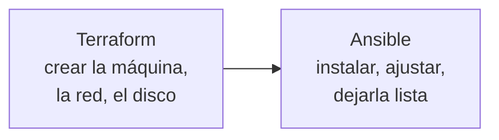

**Dónde estás:** ya sabes montar un servidor, empaquetar la aplicación, comprobarla sola, desplegarla y decidir cuándo hace falta más de una máquina. Todo eso lo hiciste a mano al menos una vez. Aquí ese trabajo manual se convierte en archivos.

## Lo último que sigue viviendo en la memoria de alguien

Repasa lo que ya está escrito en tu repositorio: el código, las pruebas, el `Dockerfile`, el workflow de CI, el archivo de Compose. Ahora repasa lo que no: qué tipo de instancia pediste, qué puertos abriste en el panel del proveedor, qué paquetes instalaste, qué línea cambiaste en `sshd_config`.

Esa segunda lista es la única parte del sistema que sigue dependiendo de que alguien se acuerde. Y es la que hace falta cuando la máquina desaparece.

## Dos trabajos, dos herramientas

La distinción no es de gusto: son problemas distintos. Crear un servidor pasa por la API del proveedor y hay que recordar qué se creó para no duplicarlo. Configurar lo de dentro pasa por SSH y se puede comprobar cada vez, sin recordar nada.

Por eso Terraform guarda un archivo de estado y Ansible no lo necesita.

## El recorrido

| Momento | Pregunta | Página |
| --- | --- | --- |
| Motivo | ¿Qué se rompe cuando la infraestructura solo existe en una máquina? | [Por qué escribir la infraestructura](/infrastructure/why-iac/) |
| Crear | ¿Cómo declaro los recursos y qué es ese archivo de estado? | [Terraform y el estado](/infrastructure/terraform/) |
| Configurar | ¿Cómo dejo una máquina como debe quedar, mil veces seguidas? | [Ansible y la idempotencia](/infrastructure/ansible/) |

:::note[Escribir la infraestructura también tiene coste]
Añade un lenguaje, una herramienta y —en el caso de Terraform— un estado que hay que guardar, cifrar y bloquear. Con una máquina y un entorno que reconstruirías en una tarde, ese coste no se recupera. Empieza a compensar cuando hay dos entornos que deben parecerse o dos personas con acceso.
:::

## Qué cubre

Estas páginas cubren cómo declarar los recursos de un entorno sin tocar un panel web, cómo dejar la configuración de una máquina en un archivo que se puede aplicar más de una vez, y por qué dos servidores que empezaron iguales dejan de serlo.
