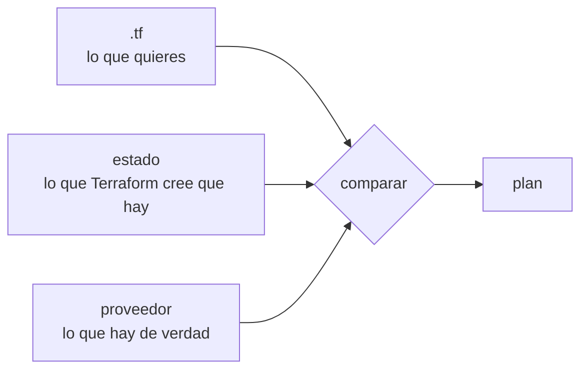

:::note
Terraform lo he estudiado, pero no lo uso en un sistema real. En [Sobre este sitio](/about/) está el detalle de qué opero y qué no.
:::

## Describir en vez de pedir

Terraform lee archivos `.tf` que declaran qué recursos deben existir, consulta al proveedor qué hay realmente, y calcula las acciones para que coincidan.

```hcl
terraform {
  required_providers {
    hcloud = { source = "hetznercloud/hcloud", version = "~> 1.50" }
  }
}

resource "hcloud_server" "app" {
  name        = "atlas-app"
  image       = "ubuntu-24.04"
  server_type = "cx22"
  location    = "nbg1"
  ssh_keys    = [hcloud_ssh_key.deploy.id]
}

resource "hcloud_firewall" "web" {
  name = "atlas-web"

  rule {
    direction  = "in"
    protocol   = "tcp"
    port       = "443"
    source_ips = ["0.0.0.0/0", "::/0"]
  }
}
```

La referencia `hcloud_ssh_key.deploy.id` hace dos cosas a la vez: usa el valor y declara una dependencia. Terraform deduce de ahí en qué orden crear las cosas; tú no escribes ese orden en ninguna parte.

## El ciclo

```bash
terraform init          # descarga los proveedores declarados
terraform plan          # qué haría, sin hacerlo
terraform apply         # lo hace, tras confirmación
terraform destroy       # borra todo lo que gestiona
```

`plan` es la parte que no conviene saltarse. Su salida distingue tres símbolos, y el tercero es el que importa:

```
  + create        un recurso nuevo
  ~ update        se modifica en sitio
-/+ destroy and then create   se borra y se rehace
```

Ese `-/+` aparece cuando cambias un atributo que el proveedor no puede modificar sobre la marcha —el tipo de imagen de un servidor, a veces su ubicación—. En una base de datos significa perder los datos. El plan es el único momento en que eso se ve antes de que ocurra.

## El estado

Terraform necesita saber que el servidor `atlas-app` de tu archivo es *ese* servidor concreto en el proveedor, y no uno nuevo. Esa correspondencia vive en el **archivo de estado**, un JSON que se escribe en cada `apply`.



Sin estado, Terraform no puede distinguir "este recurso ya existe y cambió" de "este recurso no existe": crearía todo otra vez.

Tres consecuencias prácticas:

- **El estado contiene secretos en claro.** Contraseñas generadas, claves, cadenas de conexión: lo que el proveedor devuelva queda escrito ahí. No va al repositorio.
- **Compartido y con bloqueo.** Si dos personas aplican a la vez sobre el mismo estado, se corrompe. Los backends remotos —S3, GCS, HCP Terraform— guardan el archivo y toman un bloqueo mientras alguien aplica.
- **Puede desincronizarse.** Si alguien borra el servidor desde el panel web, el estado sigue creyendo que existe. El siguiente `plan` lo detecta y propone recrearlo.

```hcl
terraform {
  backend "s3" {
    bucket       = "atlas-tfstate"
    key          = "prod/terraform.tfstate"
    region       = "eu-central-1"
    use_lockfile = true     # bloqueo en el propio bucket
    encrypt      = true
  }
}
```

:::caution[El estado es tan sensible como tus credenciales]
Un archivo de estado filtrado entrega el inventario completo de tu infraestructura y los secretos que el proveedor devolvió al crearla. Cífralo en reposo, restringe quién lo lee, y nunca lo subas al repositorio — un `.gitignore` con `*.tfstate` es lo primero que se escribe.
:::

## Módulos y entornos

Cuando *staging* y producción deben parecerse, lo que se repite se convierte en un **módulo**: un conjunto de recursos parametrizado que se instancia con valores distintos.

```hcl
module "staging" {
  source      = "./modules/environment"
  environment = "staging"
  server_type = "cx22"
}

module "production" {
  source      = "./modules/environment"
  environment = "production"
  server_type = "cx42"
}
```

Ambos entornos comparten definición y difieren solo en lo declarado. Las dos descripciones ya no pueden separarse, porque es una sola. Lo que sí puede seguir cambiando es la máquina real, a mano y por fuera; eso lo delata el siguiente `plan`.

Cada entorno necesita su propio estado. Mezclarlos en uno significa que un `apply` destinado a *staging* tiene delante los recursos de producción.

## Sigue explorando

- [Terraform · lenguaje](https://developer.hashicorp.com/terraform/language) — la referencia de recursos, variables y módulos.
- [Terraform · estado remoto](https://developer.hashicorp.com/terraform/language/state/remote) — backends, bloqueo y cifrado.
- [OpenTofu](https://opentofu.org/) — la bifurcación de código abierto, compatible con la misma sintaxis.
