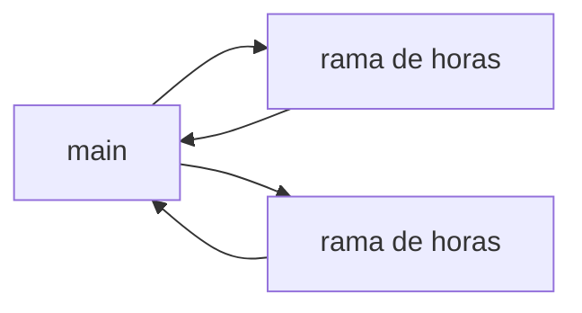
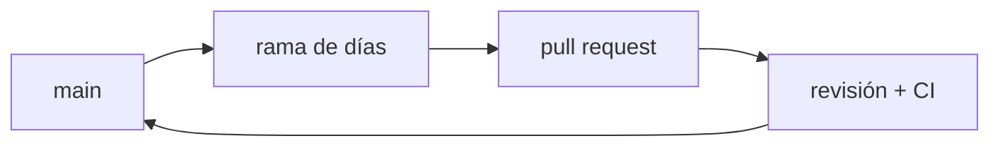
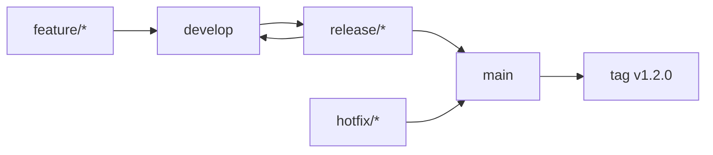

## De qué depende el modelo de ramas

Los nombres —trunk-based, GitHub Flow, GitFlow— parecen estilos entre los que se elige por gusto, pero cada uno responde a una pregunta concreta sobre cómo entregas:

> ¿Cuánto tiempo puede existir un cambio sin integrarse con el trabajo de los demás?

Todo lo demás —cuántas ramas hay, cómo se llaman, quién puede escribir en cuál— se deduce de esa respuesta. Por eso este tema no está junto a los comandos de Git: no se puede responder antes de saber qué cuesta un despliegue.

## Tres preguntas que deciden por ti

| Pregunta | Si la respuesta es… | Entonces |
| --- | --- | --- |
| ¿Cuántas versiones publicadas sostienes a la vez? | Una | No necesitas ramas de release |
| | Varias, con parches para cada una | Necesitas ramas de release |
| ¿Cuántos entornos hay entre `main` y producción? | Ninguno o uno | El artefacto puede salir de `main` |
| | Varios, con aprobación humana | Necesitas un punto de corte con nombre |
| ¿Cuánto tarda tu CI en dar un veredicto? | Minutos | Puedes integrar varias veces al día |
| | Horas | Vas a acumular trabajo sin integrar |

Si las tres respuestas caen en la primera fila, un modelo complejo solo añade coste.

## Los tres modelos

### Trunk-based

Todo el mundo integra en `main` al menos una vez al día. Las ramas duran horas, no días. Lo que no está terminado se publica igualmente, apagado detrás de un *feature flag*: una condición en el código que decide en tiempo de ejecución si esa función está activa, de modo que el código puede viajar a producción sin que la función esté disponible.

Exige CI rápida y una suite en la que confíes, porque casi no hay ventana entre escribir y publicar. A cambio, los conflictos de merge prácticamente desaparecen: nadie se aleja lo suficiente del tronco como para chocar.

### GitHub Flow

Una rama por intención, un pull request por rama, `main` siempre desplegable. Es trunk-based con una parada de revisión explícita y ramas algo más largas.

Es un punto de partida razonable: mantiene una sola línea de verdad y sigue permitiendo que otra persona lea el cambio antes de que entre. La afirmación "`main` siempre está desplegable" es lo que lo sostiene, y solo es cierta si CI la comprueba de verdad.

### GitFlow

Dos ramas permanentes (`main` y `develop`) más tres familias temporales (`feature/*`, `release/*`, `hotfix/*`). `main` solo recibe versiones publicadas y etiquetadas; el trabajo diario vive en `develop`.

Resuelve un problema real: sostener varias versiones publicadas a la vez y poder parchear una antigua sin arrastrar lo que ya está en desarrollo. Ese es el caso del software que se instala en casa del cliente, no el de una aplicación web con un solo despliegue vivo.

## Lo que cuesta cada uno

| Modelo | Cuándo devuelve su coste | Qué te cobra |
| --- | --- | --- |
| Trunk-based | Un despliegue vivo, CI de minutos, suite fiable | Necesitas *feature flags* y disciplina diaria |
| GitHub Flow | Un despliegue vivo, revisión por pull request | Ramas de días: algún conflicto y colas de revisión |
| GitFlow | Varias versiones publicadas con soporte simultáneo | Dos ramas permanentes que se desincronizan y merges grandes |

## El coste de una rama larga

Una rama que lleva tres semanas sin tocar `main` no está "en progreso": es una integración aplazada. Mientras tanto `main` avanzó, y el conflicto que resolverás al final es la suma de todos los conflictos que habrías resuelto uno a uno.

El coste no crece de forma lineal. Crece con el número de cambios ajenos que ocurrieron mientras no mirabas, y cada uno de ellos puede interactuar con los tuyos.

:::caution[GitFlow por defecto sale caro]
Adoptar `develop`, `release/*` y `hotfix/*` en un proyecto con un único despliegue vivo añade dos merges por cambio y una rama que se desincroniza, a cambio de una capacidad —parchear una versión antigua— que no vas a usar. Si no tienes clientes en distintas versiones, no necesitas GitFlow.
:::

## Sigue explorando

- [Trunk Based Development](https://trunkbaseddevelopment.com/) — el modelo explicado por quienes lo defienden.
- [GitHub Flow (guía oficial)](https://docs.github.com/es/get-started/using-github/github-flow) — el flujo en su forma canónica.
- [A successful Git branching model](https://nvie.com/posts/a-successful-git-branching-model/) — el artículo original de GitFlow, con la nota del autor sobre cuándo no usarlo.
