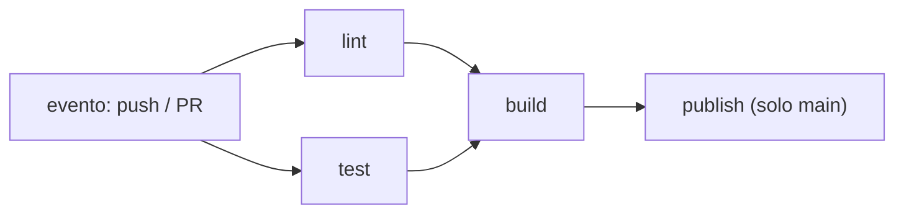

## Un workflow es una promesa ejecutable

GitHub Actions describe qué ocurre ante eventos del repositorio (`push`, `pull_request`, etiquetas). Un workflow se compone de **jobs** —que corren en máquinas separadas y en paralelo— y cada job de **pasos** en orden.

Esa máquina se llama **runner**. `runs-on: ubuntu-latest` pide una máquina virtual Linux recién creada, que se destruye al terminar el job: nada sobrevive de una ejecución a la siguiente, y por eso cada workflow tiene que instalar lo que necesita.



## Validar con lint, pruebas y build

Un buen pipeline no solo compila: revisa formato, tipos y comportamiento antes de empaquetar.

El **lint** es la comprobación más barata de todas: un programa lee el código sin ejecutarlo y señala lo que rompe una convención o huele a error —una variable sin usar, un `await` que falta, una importación que ya no existe—. Tarda segundos, así que su veredicto llega primero.

```yaml
name: CI
on:
  pull_request:
  push:
    branches: [main]

jobs:
  lint:
    runs-on: ubuntu-latest
    steps:
      - uses: actions/checkout@v4
      - uses: actions/setup-node@v4
        with:
          node-version: 22
          cache: npm
      - run: npm ci
      - run: npm run lint         # formato y convenciones

  test:
    runs-on: ubuntu-latest
    steps:
      - uses: actions/checkout@v4
      - uses: actions/setup-node@v4
        with:
          node-version: 22
          cache: npm
      - run: npm ci
      - run: npm test             # comportamiento

  build:
    needs: [lint, test]           # espera a que lint y test pasen
    runs-on: ubuntu-latest
    steps:
      - uses: actions/checkout@v4
      - uses: actions/setup-node@v4
        with:
          node-version: 22
          cache: npm
      - run: npm ci
      - run: npm run build
```

`cache: npm` reutiliza dependencias entre ejecuciones; `lint` y `test` corren en paralelo y `needs: [lint, test]` hace que `build` espere a ambos. Cada paso debe decir qué garantiza y qué evidencia deja.

## Validar no es desplegar

Los pull requests ejecutan validaciones sin tocar producción. Solo después de integrar en `main` se construye la imagen publicable y se despliega, normalmente en un job aparte protegido por un **environment**:

```yaml
  deploy:
    needs: build
    if: github.ref == 'refs/heads/main'
    environment: production
    runs-on: ubuntu-latest
    steps:
      - run: echo "publicar imagen y desplegar"
```

El `if` limita el deploy a `main`; el `environment` permite exigir aprobaciones o guardar secretos por entorno.

:::tip[Trata el pipeline como producto]
Un error de CI es una experiencia de usuario. Mensajes cortos, comandos reproducibles y artefactos visibles reducen el tiempo entre fallo y aprendizaje.
:::

## Secretos y permisos

Un **secreto** es un valor que da acceso a algo: un token, una clave de API, la contraseña con la que el pipeline entra al servidor. Viven guardados en GitHub, nunca en el YAML ni en el repositorio —quien clone el código se los llevaría— y el workflow los recibe como variables que el registro de ejecución oculta.

Los **permisos** son la otra mitad: concede a cada job lo mínimo que necesita: leer código para validar y escribir paquetes solo en el job que publica.

```yaml
permissions:
  contents: read
  packages: write
```

Dónde viven exactamente, por qué el permiso importa más que el escondite, y qué hacer cuando uno se escapa: [Secretos y permisos](/integration/secrets/).

## Comprueba lo que entendiste

<details>
<summary>Quieres que build solo corra si test pasa. ¿Qué usas?</summary>

`needs: test` en el job build. Por defecto los jobs corren en paralelo; `needs` declara una dependencia y hace que build espere a que test termine con éxito.

</details>

<details>
<summary>Tu deploy corre en cada pull request. ¿Cómo lo limitas a main?</summary>

Con una condición en el job, `if: github.ref == 'refs/heads/main'`, idealmente combinada con un `environment` que exija aprobación. La validación corre en cada PR; el despliegue, solo tras integrar.

</details>

## Sigue explorando

- [GitHub Actions (documentación)](https://docs.github.com/es/actions) — eventos, jobs, contextos y expresiones.
- [Sintaxis de workflows](https://docs.github.com/es/actions/using-workflows/workflow-syntax-for-github-actions) — cada campo del YAML.
- [Environments](https://docs.github.com/es/actions/deployment/targeting-different-environments/using-environments-for-deployment) — aprobaciones y secretos por entorno.
