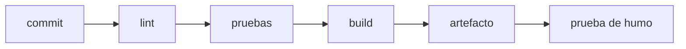

**Dónde estás:** ya sabes revisar un cambio, poner la aplicación en un servidor y empaquetarla. Todo eso depende todavía de que alguien lo haga, y de que lo haga bien. Aquí el commit deja de necesitar a una persona para convertirse en un artefacto comprobado.

## Comprobar donde nadie tiene ventaja

Hasta ahora, quien escribió el código era quien comprobaba que funcionara, en la única máquina donde ya estaba todo instalado. Eso hace que "en mi máquina funciona" sea literalmente cierto y completamente inútil.

**Integración continua** mueve la comprobación a un servidor limpio que se crea para el intento y se destruye al terminar. Nadie tiene ventaja ahí: si la construcción depende de una variable de entorno que solo existe en tu portátil, falla, y falla en el momento en que se puede arreglar barato.

## Una prueba es una afirmación que se ejecuta

Lo que ese servidor ejecuta son, sobre todo, pruebas. Una prueba automática afirma algo concreto: dada cierta entrada, el sistema responde de cierta forma. Cuando falla, deja una evidencia reproducible.

Si ya programas, probablemente esto no sea nuevo. Lo que cambia aquí es dónde vive la suite: deja de ser una comprobación que corres cuando te acuerdas y pasa a ser una **compuerta del camino de entrega**. Se ejecuta sola en cada cambio y su resultado decide si el artefacto sigue avanzando.

:::note[Una prueba que nunca falla no protege nada]
Si una prueba pasa siempre, aunque rompas el código, no está probando lo que crees. Una buena prueba falla cuando el comportamiento cambia.
:::

## Tres palabras que vas a leer mucho

- **Pipeline**: la secuencia automática de etapas que recorre un cambio desde el commit hasta quedar publicado. Cada etapa deja evidencia y puede detener el avance.
- **Artefacto**: el resultado empaquetado de una construcción —una imagen de contenedor, un `.jar`, una carpeta de archivos estáticos—. Es lo que se despliega, y no es lo mismo que el código del que salió.
- **Entorno**: una instalación completa del sistema, con su propia configuración y sus propios datos. Lo habitual son tres —desarrollo, *staging* y **producción**— y solo en la última hay usuarios reales.

## La cadena de integración

El orden importa: lo barato va primero. Un lint que tarda diez segundos debe fallar antes que una suite que tarda ocho minutos, porque el feedback que llega primero es el que se usa.

## El recorrido

| Momento | Pregunta | Página |
| --- | --- | --- |
| Workflow | ¿Cómo describo una comprobación automática? | [GitHub Actions](/integration/github-actions/) |
| Niveles | ¿Qué probar y en qué nivel? | [La pirámide de pruebas](/integration/pyramid/) |
| Evidencia | ¿Cómo corren las pruebas en cada cambio? | [Pruebas en CI](/integration/tests-in-ci/) |
| Ramas | ¿Qué modelo de ramas sostiene mi forma de entregar? | [Estrategias de ramas](/integration/branching-strategy/) |
| Acceso | ¿Dónde viven las credenciales que el pipeline necesita? | [Secretos y permisos](/integration/secrets/) |
| Práctica | ¿Puedo dejar una prueba y un workflow funcionando? | [Práctica · una prueba y un workflow](/integration/lab-ci/) |

:::note[Fallos que no son del código]
Si el workflow falla a menudo por razones que no son el código —una dependencia inestable, un límite de tiempo mal puesto— el equipo aprende a ignorar el rojo.
:::

## Qué cubre

Estas páginas cubren qué probar y a qué nivel, un workflow que valida cada pull request y verifica la imagen que construye, los modelos de ramas y los permisos que necesita un pipeline.

## Dónde se rompe esto

| Síntoma | Qué lo causa | Dónde sigue |
| --- | --- | --- |
| El artefacto está comprobado y aun así alguien entra por SSH a copiarlo | La automatización termina en el registro y no llega al servidor | [Desplegar desde el pipeline](/deployment/deploy-from-pipeline/) |
| Al actualizar, la aplicación queda caída unos segundos | Se reemplaza el proceso en sitio, sin nada que reciba el tráfico mientras tanto | [Estrategias de despliegue](/deployment/strategies/) |
| La suite verde no dice nada sobre lo que ya está en producción | Una prueba afirma sobre el código, no sobre el servicio en marcha | [Observabilidad](/scaling/observability/) |
