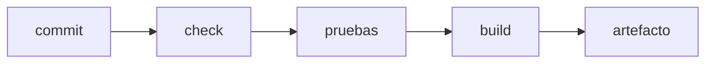

**Dónde estás:** ya sabes revisar un cambio y empaquetar la aplicación. Lo que falta es que todo eso ocurra solo. Aquí el commit deja de necesitar a una persona para convertirse en un artefacto comprobado.

## Comprobar donde nadie tiene ventaja

Hasta ahora, quien escribió el código era quien comprobaba que funcionara, en la única máquina donde ya estaba todo instalado. Eso hace que "en mi máquina funciona" sea literalmente cierto y completamente inútil.

**Integración continua** mueve la comprobación a un servidor limpio que se crea para el intento y se destruye al terminar. Nadie tiene ventaja ahí: si la construcción depende de una variable de entorno que solo existe en tu portátil, falla, y falla en el momento en que se puede arreglar barato.

## Tres palabras que vas a leer mucho

- **Pipeline**: la secuencia automática de etapas que recorre un cambio desde el commit hasta quedar publicado. Cada etapa deja evidencia y puede detener el avance.
- **Artefacto**: el resultado empaquetado de una construcción —una imagen de contenedor, un `.jar`, una carpeta de archivos estáticos—. Es lo que se despliega, y no es lo mismo que el código del que salió.
- **Entorno**: una instalación completa del sistema, con su propia configuración y sus propios datos. Lo habitual son tres —desarrollo, *staging* y **producción**— y solo en la última hay usuarios reales.

## La cadena de integración

El orden importa: lo barato va primero. Un lint que tarda diez segundos debe fallar antes que una suite que tarda ocho minutos, porque el feedback que llega primero es el que se usa.

## Mapa del módulo

| Momento | Pregunta | Página |
| --- | --- | --- |
| Workflow | ¿Cómo describo una comprobación automática? | [GitHub Actions](/integration/github-actions/) |
| Ramas | ¿Qué modelo de ramas sostiene mi forma de entregar? | [Estrategias de ramas](/integration/branching-strategy/) |
| Evidencia | ¿Cómo corren las pruebas en cada cambio? | [Pruebas en CI](/integration/tests-in-ci/) |
| Acceso | ¿Dónde viven las credenciales que el pipeline necesita? | [Secretos y permisos](/integration/secrets/) |

:::note[Una comprobación que nadie mira no es una compuerta]
Si el workflow falla a menudo por razones que no son el código —una dependencia inestable, un límite de tiempo mal puesto— el equipo aprende a ignorar el rojo. Una comprobación que se ignora cuesta lo mismo y no protege nada.
:::

## Qué puedes hacer con esto

Con estas páginas puedes escribir un workflow que valide cada pull request, elegir un modelo de ramas y justificarlo, y ordenar los pasos para que el feedback llegue en el orden correcto.

## Dónde se rompe esto

| Síntoma | Qué lo causa | Dónde sigue |
| --- | --- | --- |
| El artefacto está comprobado y aun así alguien entra por SSH a copiarlo | La automatización termina en el registro y no llega al servidor | [Del build al release](/deployment/pipeline/) |
| Al actualizar, la aplicación queda caída unos segundos | Se reemplaza el proceso en sitio, sin nada que reciba el tráfico mientras tanto | [Estrategias de despliegue](/deployment/strategies/) |
| El despliegue terminó bien y nadie sabe si el servicio quedó sano | La evidencia se acaba en el pipeline y no continúa en producción | [Observabilidad](/scaling/observability/) |
