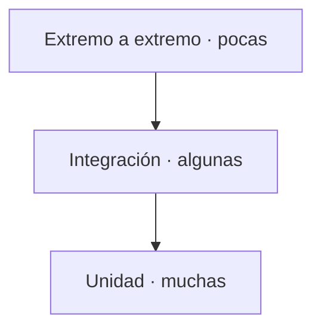

## Tres niveles, tres preguntas



- **Unidad**: prueba una función o módulo aislado. Rápida, precisa, barata. Responde: ¿esta pieza hace lo que digo?
- **Integración**: prueba que varias piezas colaboran (por ejemplo, código más base de datos). Responde: ¿encajan entre sí?
- **Extremo a extremo (E2E)**: prueba el sistema como lo usa una persona. Lenta y valiosa. Responde: ¿el recorrido completo funciona?

La forma de pirámide tiene un motivo: conviene tener **muchas** pruebas de unidad (rápidas) y **pocas** E2E (lentas). Invertir la pirámide —casi todo E2E— produce suites lentas y frágiles.

## Qué hace buena a una prueba

- **Determinista**: mismo input, mismo resultado, sin depender de la hora o de la red.
- **Aislada**: no depende del orden ni de otra prueba.
- **Legible**: su nombre dice qué comportamiento protege.

```js
import { test } from 'node:test';
import assert from 'node:assert/strict';

// una prueba de unidad: el nombre describe el comportamiento esperado
test('suma ignora valores nulos', () => {
  assert.equal(sum([1, null, 2]), 3);
});
```

## Pruebas frágiles

Una prueba **frágil** falla por razones ajenas al comportamiento: un timeout, un selector que cambió, un dato aleatorio. Cada falla falsa erosiona la confianza hasta que el equipo ignora la suite, y entonces no protege nada. Prefiere pocas pruebas confiables antes que muchas ruidosas.

:::caution[No pruebes la implementación, prueba el comportamiento]
Una prueba atada a detalles internos se rompe con cada refactor, aunque el comportamiento no cambie. Afirma qué hace el sistema, no cómo lo hace.
:::

## Sigue explorando

- [The Practical Test Pyramid (Martin Fowler)](https://martinfowler.com/articles/practical-test-pyramid.html) — el artículo de referencia.
- [Google Testing Blog](https://testing.googleblog.com/) — prácticas de prueba a escala.
