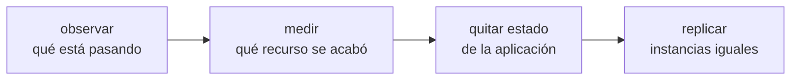

**Dónde estás:** tienes un servidor que sirve tráfico, un pipeline que despliega solo y la capacidad de revertir. Aquí empiezan las preguntas que no tienen una respuesta técnica única, porque dependen de números que solo tú puedes medir.

## Crecer no es comprar máquinas

La imagen habitual de escalar —añadir servidores— describe el último paso y esconde los tres anteriores. En orden de lo que de verdad ocurre:

Los dos primeros pasos evitan gastos innecesarios: lo que parece falta de capacidad puede ser una consulta sin índice. El tercero es el que más trabajo lleva. El cuarto es casi mecánico cuando los otros están hechos.

## Qué límite tiene un solo servidor

| Límite | Se nota como | Dónde se resuelve |
| --- | --- | --- |
| No sabes qué está pasando dentro | Te enteras de las caídas por un mensaje de un usuario | [Observabilidad](/scaling/observability/) |
| Un recurso concreto se agota | Latencia que sube con el tráfico | [Cuándo escalar y cómo](/scaling/when-to-scale/) |
| Los datos viven en el mismo disco | Replicar la aplicación rompe sesiones y archivos | [Sacar el estado de la máquina](/scaling/managed-services/) |
| Con varias máquinas, alguien reparte a mano | Un despliegue son muchos pasos manuales repetidos | [Orquestación](/scaling/orchestration/) |

## Cada escalón cuesta operación

Esa tabla no es una escalera que haya que subir entera. Cada paso añade piezas que hay que entender cuando fallan.

Una VPS bien operada —con respaldos probados, certificado que se renueva solo y un despliegue automatizado— da bastante margen. La pregunta útil es qué medición dice que ya no alcanza.

:::note[Menos piezas]
Conviene sostener la carga real con la menor cantidad de piezas que el equipo pueda operar bien. A veces eso es una máquina más grande.
:::

## Qué cubre

Estas páginas cubren cómo instrumentar un servicio y leer sus señales, la diferencia entre un problema de eficiencia y uno de capacidad, cómo sacar el estado de las instancias y cuándo compensa un orquestador.

## Dónde se rompe esto

| Síntoma | Qué lo causa | Dónde sigue |
| --- | --- | --- |
| La segunda máquina no queda igual que la primera | Los pasos para construirla siguen sin estar escritos en ninguna parte | [Infraestructura como código](/infrastructure/) |
| Un arreglo urgente se aplicó en un servidor y no en los otros | No hay una definición común contra la que comparar | [Por qué escribir la infraestructura](/infrastructure/why-iac/) |
| Crear el entorno de staging vuelve a ser una tarde de trabajo manual | Los recursos se piden por un panel web, así que no se pueden repetir | [Terraform y el estado](/infrastructure/terraform/) |
