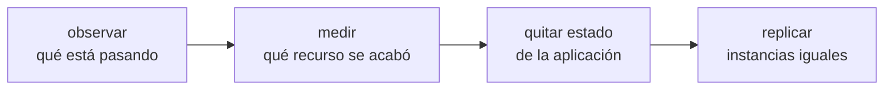

**Dónde estás:** tienes un servidor que sirve tráfico, un pipeline que despliega solo y la capacidad de revertir. Aquí empiezan las preguntas que no tienen una respuesta técnica única, porque dependen de números que solo tú puedes medir.

## Crecer no es comprar máquinas

La imagen habitual de escalar —añadir servidores— describe el último paso y esconde los tres anteriores. En orden de lo que de verdad ocurre:

Los dos primeros pasos evitan la mayoría de los gastos innecesarios: buena parte de lo que parece falta de capacidad es una consulta sin índice. El tercero es el trabajo real, y el único que no se puede comprar. El cuarto es casi mecánico cuando los otros están hechos.

## Qué límite tiene un solo servidor

| Límite | Se nota como | Dónde se resuelve |
| --- | --- | --- |
| No sabes qué está pasando dentro | Te enteras de las caídas por un mensaje de un usuario | [Observabilidad](/scaling/observability/) |
| Un recurso concreto se agota | Latencia que sube con el tráfico | [Cuándo escalar y cómo](/scaling/when-to-scale/) |
| Los datos viven en el mismo disco | Replicar la aplicación rompe sesiones y archivos | [Sacar el estado de la máquina](/scaling/managed-services/) |
| Con varias máquinas, alguien reparte a mano | Un despliegue son muchos pasos manuales repetidos | [Orquestación](/scaling/orchestration/) |

## Cada escalón cuesta operación

Es tentador leer esa tabla como una escalera que hay que subir entera. No lo es. Cada paso añade piezas que hay que entender cuando fallan, y el sistema más fiable es el que tiene menos cosas que puedan fallar.

Una VPS bien operada —con respaldos probados, certificado que se renueva solo y un despliegue automatizado— atiende más tráfico del que la mayoría de los proyectos ve nunca. La pregunta útil no es "cómo escalo", sino "qué medición me dice que ya no me alcanza".

:::note[Escalar no es una señal de madurez]
Un sistema no es mejor por tener más partes. La decisión correcta es la que sostiene tu carga real con la menor cantidad de piezas que tu equipo pueda operar bien. A veces esa decisión es una máquina más grande, y no hay nada que justificar.
:::

## Qué puedes hacer con esto

Con estas páginas puedes instrumentar un servicio, leer sus señales, distinguir un problema de eficiencia de uno de capacidad, sacar el estado de tus instancias y decidir con criterio si un orquestador te compensa.

## Dónde se rompe esto

| Síntoma | Qué lo causa | Dónde sigue |
| --- | --- | --- |
| La segunda máquina no queda igual que la primera | Los pasos para construirla siguen sin estar escritos en ninguna parte | [Infraestructura como código](/infrastructure/) |
| Un arreglo urgente se aplicó en un servidor y no en los otros | No hay una definición común contra la que comparar | [Por qué escribir la infraestructura](/infrastructure/why-iac/) |
| Crear el entorno de staging vuelve a ser una tarde de trabajo manual | Los recursos se piden por un panel web, así que no se pueden repetir | [Terraform y el estado](/infrastructure/terraform/) |
