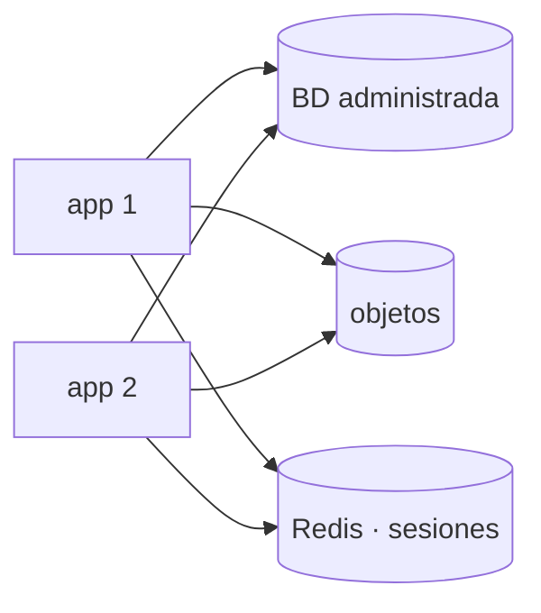

## Qué guarda estado en tu servidor

Antes de replicar nada, hay que saber qué se rompería al hacerlo. **Estado** es cualquier cosa que sobrevive a una petición y que otra instancia no tendría.

| Qué hay en la máquina | ¿Tiene estado? | Dónde debería vivir |
| --- | --- | --- |
| El código y las dependencias | No | La imagen o el repositorio |
| La base de datos | Sí | Un servicio propio |
| Los archivos que suben los usuarios | Sí | Almacenamiento de objetos |
| Las sesiones en memoria | Sí | Redis o la base de datos |
| La caché en memoria del proceso | Sí, a medias | Redis, o aceptar que se pierde |
| Los logs en `/var/log` | Sí | Un recolector externo |
| Los trabajos programados con `cron` | Sí, de hecho | Un planificador con bloqueo |

Las tres primeras filas son las que cuestan trabajo. Las demás se resuelven casi solas cuando las anteriores están hechas.

## La base de datos: administrada o tuya

Es la decisión de más peso y no tiene una respuesta única. Lo que compras al pagar por una administrada no es funcionalidad —PostgreSQL es el mismo— sino **operación**: respaldos con recuperación a un punto en el tiempo, réplicas, actualizaciones de versión, conmutación por fallo, y a alguien a quien llamar de madrugada.

| | La operas tú | Administrada |
| --- | --- | --- |
| Coste mensual | Bajo | 2× a 5× |
| Respaldos y su prueba | Tu responsabilidad | Incluidos |
| Actualizaciones de versión | Tu ventana de mantenimiento | Programada |
| Recuperar a un punto en el tiempo | Hay que montarla | Un botón |
| Réplicas de lectura | Trabajo real | Un botón |
| Ajuste fino | Control total | Limitado por el proveedor |

La regla práctica: si nadie del equipo puede responder ahora mismo cuándo se restauró por última vez un respaldo, ya estás pagando el precio de operarla, solo que en riesgo en lugar de en factura.

:::note[Salir de una administrada es más difícil que entrar]
La migración de entrada la hace un `pg_dump` y un `pg_restore`. La de salida también, pero para entonces dependes de sus respaldos, de sus réplicas y a veces de extensiones que solo ese proveedor ofrece. Conviene saber, el día que entras, cómo sería salir.
:::

## Archivos: de un disco a un servicio

Un archivo subido a `/srv/miapp/uploads` vive en una sola máquina. Con dos instancias, la mitad de las descargas no lo encuentra.

El **almacenamiento de objetos** —S3 y sus equivalentes— resuelve eso convirtiendo el archivo en algo que se pide por HTTP a un servicio, no a un disco. Además desaparecen tres problemas de golpe: la capacidad deja de ser un número fijo, las copias entre regiones son configuración, y el archivo se puede servir desde una CDN sin pasar por tu aplicación.

Dos detalles que se olvidan al migrar:

- **Las URL existentes.** Si tus archivos se servían desde `/uploads/foto.jpg`, esa ruta tiene que seguir funcionando, aunque sea redirigiendo al objeto nuevo.
- **Las subidas no deberían pasar por tu servidor.** El patrón habitual es la *URL prefirmada*: tu aplicación firma un permiso temporal y el navegador sube directo al almacenamiento. Así una subida de 500 MB no ocupa un proceso tuyo durante minutos.

Cuando el diagrama queda así, las instancias son verdaderamente intercambiables: cualquiera atiende cualquier petición, y borrar una no pierde nada.

## Sesiones y trabajos programados

Las **sesiones** en memoria son el estado que más rápido se nota: el usuario inicia sesión y la petición siguiente le pide iniciar sesión otra vez. Se mueven a Redis o a la base de datos, y suele ser un cambio de configuración del framework.

Los **trabajos programados** son el estado que más tarde se nota. Un `cron` que envía el resumen diario, replicado en tres instancias, envía tres correos a cada persona. La salida es que solo una instancia lo ejecute: un bloqueo compartido, o un planificador externo que dispare el trabajo una vez.

## Sigue explorando

- [The Twelve-Factor App · servicios de respaldo](https://12factor.net/es/backing-services) — tratar cada dependencia como un recurso conectable.
- [AWS · URL prefirmadas](https://docs.aws.amazon.com/es_es/AmazonS3/latest/userguide/using-presigned-url.html) — subir sin pasar por tu servidor.
