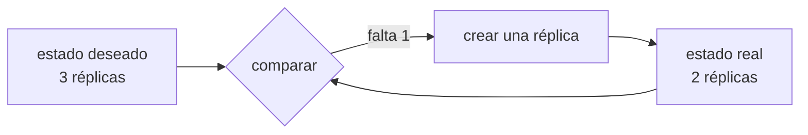

## Qué queda por resolver

Supón que ya llegaste hasta aquí: la aplicación está empaquetada, el estado vive fuera, hay varias instancias y un balanceador delante. Sigue habiendo trabajo que hace una persona:

- Decidir en qué máquina corre cada copia, y rehacerlo cuando añades una máquina.
- Levantar de nuevo una instancia que murió, en otro sitio si su servidor cayó.
- Durante un despliegue, sacar de rotación, actualizar, esperar a que responda y devolver — instancia por instancia.
- Repartir la carga cuando una máquina está llena y otra vacía.
- Entregar secretos y configuración a cada copia sin dejarlos en la imagen.

Un **orquestador** es un programa que hace todo eso. Y lo hace de una forma concreta que es la parte importante.

## Declarar en vez de ejecutar

Tu script de despliegue dice *pasos*: conéctate, para esto, copia aquello, arranca. Si falla a mitad, quedas en un estado que nadie describió.

Un orquestador recibe una *descripción del resultado*: "quiero tres réplicas de esta imagen, con este límite de memoria, alcanzables en este nombre". Después compara continuamente ese estado deseado con el real y actúa para acercarlos.

Esa diferencia explica el resto. Nadie "reinicia" un contenedor caído: se declara que deben existir tres, y el bucle nota que hay dos. Un despliegue no es un script, es cambiar la imagen declarada y dejar que el bucle reemplace las réplicas al ritmo que le pediste.

## Las opciones, por lo que cuestan

| Opción | Qué te ahorra | Qué te cobra |
| --- | --- | --- |
| **Docker Compose** en una máquina | Levantar varios contenedores juntos | No reparte entre máquinas ni cura nada |
| **Docker Swarm** | Varias máquinas, réplicas, rolling, secretos | Comunidad y desarrollo escasos |
| **Nomad** | Orquesta contenedores y también procesos normales | Ecosistema más pequeño |
| **Kubernetes administrado** (EKS, GKE, AKS) | Todo lo anterior más un ecosistema enorme | Complejidad conceptual real y facturación por plano de control |
| **Plataformas de contenedor** (Cloud Run, ECS Fargate, Fly.io) | Casi toda la operación | Menos control y ataduras al proveedor |

Kubernetes es el estándar de facto, y por eso es la respuesta que se oye siempre. También es la que introduce más conceptos nuevos a la vez: pods, servicios, ingress, ConfigMaps, y su propia red. Aprenderlo no es el problema. Operarlo la noche en que un nodo se queda sin memoria y no sabes cuál de esas capas está mintiendo, sí.

:::caution[El coste de un orquestador no es aprenderlo]
Casi cualquiera monta un clúster en una tarde siguiendo una guía. La factura llega el día que algo falla y hay que saber si el problema es del pod, del nodo, del ingress, del certificado, del DNS interno o de la política de red. Ese conocimiento no se improvisa durante una caída.
:::

## Cuándo no compensa todavía

Señales bastante fiables de que la respuesta es "aún no":

- Tienes un solo servicio. Un orquestador coordina muchas piezas; con una, coordina nada.
- Tu aplicación aún guarda estado en su memoria. Sin instancias intercambiables no hay nada que repartir, y el orquestador solo hará el problema más difícil de ver.
- Nadie del equipo ha operado uno antes. El primer incidente real llegará antes que la experiencia.
- Tu tráfico cabe holgado en una máquina de tamaño medio.

Y señales de que sí compensa: varios servicios que se despliegan por separado, varios equipos que necesitan no pisarse, o una carga tan variable que dimensionar a mano es adivinar.

Entre las dos hay un punto intermedio que se menciona poco: una **plataforma de contenedores administrada**. Le entregas la imagen y te devuelve una URL con TLS, escalado y despliegue gradual, sin clúster que operar. Para la mayoría de los proyectos que "necesitan Kubernetes", esto es lo que necesitaban de verdad.

## Comprueba lo que entendiste

¿Qué diferencia hay entre un script de despliegue y un orquestador?

El script ejecuta pasos y termina; si falla a mitad, deja un estado que nadie describió. El orquestador guarda una descripción del resultado deseado y compara sin parar con el real, actuando para acercarlos. Por eso recupera solo de una caída: nadie le pidió reiniciar nada, le pidieron que existan tres réplicas.

Tu aplicación guarda las sesiones en memoria. ¿Qué pasa si la pones en Kubernetes?

Los mismos fallos intermitentes que tendrías con cualquier balanceador, y más difíciles de ver: el orquestador mueve y recrea pods por su cuenta, así que las sesiones desaparecen en momentos que no correlacionan con ningún despliegue. Sacar el estado fuera es requisito previo, no una mejora posterior.

Un solo servicio, tráfico estable, equipo de tres personas. ¿Kubernetes?

No. No hay nada que coordinar y sí mucha superficie nueva que operar. Una o dos máquinas con Compose detrás de un proxy, o una plataforma de contenedores administrada, cubren ese caso con una fracción del coste operativo. Kubernetes empieza a compensar con varios servicios, varios equipos o una carga difícil de dimensionar.

## Sigue explorando

- [Kubernetes · conceptos](https://kubernetes.io/es/docs/concepts/) — el modelo declarativo y sus objetos, en la fuente.
- [Docker Swarm · modo clúster](https://docs.docker.com/engine/swarm/) — la opción pequeña, con la sintaxis que ya conoces.
- [Google Cloud Run](https://cloud.google.com/run/docs) — un ejemplo de plataforma que recibe una imagen y devuelve una URL.
