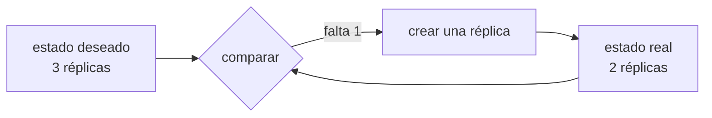

:::note
Kubernetes lo opero a diario, en un cluster k3s. Docker Swarm solo lo he estudiado. En [Sobre este sitio](/about/) está el detalle de qué opero y qué no.
:::

## Qué queda por resolver

Supón que ya llegaste hasta aquí: la aplicación está empaquetada, el estado vive fuera, hay varias instancias y un balanceador delante. Sigue habiendo trabajo que hace una persona:

- Decidir en qué máquina corre cada copia, y rehacerlo cuando añades una máquina.
- Levantar de nuevo una instancia que murió, en otro sitio si su servidor cayó.
- Durante un despliegue, sacar de rotación, actualizar, esperar a que responda y devolver — instancia por instancia.
- Repartir la carga cuando una máquina está llena y otra vacía.
- Entregar secretos y configuración a cada copia sin dejarlos en la imagen.

Un **orquestador** es un programa que hace todo eso. Y lo hace de una forma concreta.

## Declarar en vez de ejecutar

Tu script de despliegue dice *pasos*: conéctate, para esto, copia aquello, arranca. Si falla a mitad, quedas en un estado que nadie describió.

Un orquestador recibe una *descripción del resultado*: "quiero tres réplicas de esta imagen, con este límite de memoria, alcanzables en este nombre". Después compara continuamente ese estado deseado con el real y actúa para acercarlos.

Nadie "reinicia" un contenedor caído: se declara que deben existir tres, y el bucle nota que hay dos. Un despliegue consiste en cambiar la imagen declarada y dejar que el bucle reemplace las réplicas al ritmo que le pediste.

## Las opciones, por lo que cuestan

| Opción | Qué te ahorra | Qué te cobra |
| --- | --- | --- |
| **Docker Compose** en una máquina | Levantar varios contenedores juntos | No reparte entre máquinas ni cura nada |
| **Docker Swarm** | Varias máquinas, réplicas, rolling, secretos | Comunidad y desarrollo escasos |
| **Nomad** | Orquesta contenedores y también procesos normales | Ecosistema más pequeño |
| **Kubernetes administrado** (EKS, GKE, AKS) | Todo lo anterior más un ecosistema enorme | Complejidad conceptual real y facturación por plano de control |
| **Plataformas de contenedor** (Cloud Run, ECS Fargate, Fly.io) | Casi toda la operación | Menos control y ataduras al proveedor |

Kubernetes es el estándar de facto. También es la opción que introduce más conceptos nuevos a la vez: pods, servicios, ingress, ConfigMaps, y su propia red.

:::caution[El coste de un orquestador no es aprenderlo]
Montar un clúster siguiendo una guía es rápido. El coste aparece el día que algo falla y hay que saber si el problema es del pod, del nodo, del ingress, del certificado, del DNS interno o de la política de red. Ese conocimiento no se improvisa durante una caída.
:::

## Cuándo no compensa todavía

Señales bastante fiables de que la respuesta es "aún no":

- Tienes un solo servicio. Un orquestador coordina muchas piezas; con una, coordina nada.
- Tu aplicación aún guarda estado en su memoria. Sin instancias intercambiables no hay nada que repartir, y el orquestador solo hará el problema más difícil de ver.
- Nadie del equipo ha operado uno antes. El primer incidente real llegará antes que la experiencia.
- Tu tráfico cabe holgado en una máquina de tamaño medio.

Y señales de que sí compensa: varios servicios que se despliegan por separado, varios equipos que necesitan no pisarse, o una carga tan variable que dimensionar a mano es adivinar.

Entre las dos hay un punto intermedio: una **plataforma de contenedores administrada**. Le entregas la imagen y te devuelve una URL con TLS, escalado y despliegue gradual, sin clúster que operar.

## Sigue explorando

- [Kubernetes · conceptos](https://kubernetes.io/es/docs/concepts/) — el modelo declarativo y sus objetos, en la fuente.
- [Docker Swarm · modo clúster](https://docs.docker.com/engine/swarm/) — la opción pequeña, con la sintaxis que ya conoces.
- [Google Cloud Run](https://cloud.google.com/run/docs) — un ejemplo de plataforma que recibe una imagen y devuelve una URL.
