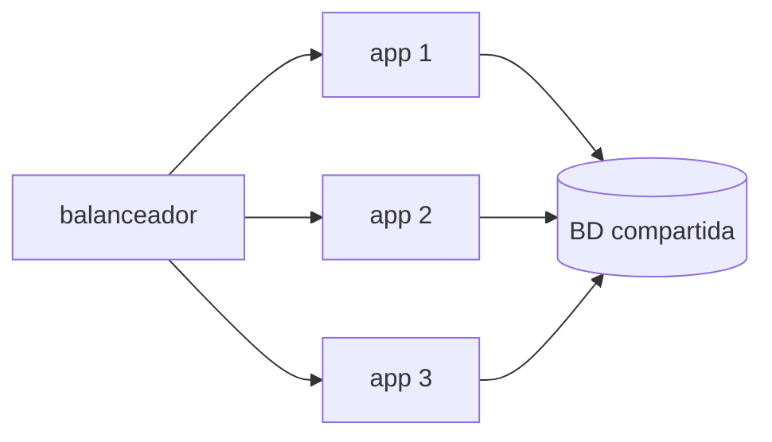

## Primero: ¿es capacidad o es eficiencia?

La pregunta que hay que responder antes de tocar nada es si al sistema le falta máquina o le sobra trabajo. Se parecen desde fuera —el sitio va lento— y tienen respuestas opuestas.

| Lo que ves | Suele ser eficiencia | Suele ser capacidad |
| --- | --- | --- |
| Latencia alta con poco tráfico | Sí | No |
| Latencia que crece con el tráfico y se estabiliza al bajar | No | Sí |
| Una sola ruta lenta y el resto bien | Sí | No |
| CPU al 30% y respuestas lentas | Sí | No |
| CPU al 95% sostenido | No | Sí |

Una consulta sin índice, una llamada dentro de un bucle, una imagen de 8 MB servida sin comprimir: nada de eso mejora con el doble de servidor, y cuesta el doble.

:::caution[Escalar puede esconder el problema]
Duplicar la máquina puede hacer que el síntoma desaparezca durante unas semanas. El problema sigue ahí, con el doble de factura. Mide antes.
:::

## Encontrar el recurso que se acabó

"El servidor está saturado" no es un diagnóstico. Se satura un recurso concreto, y cada uno se ve distinto:

```bash
uptime                  # carga media: procesos esperando por CPU
free -h                 # memoria libre y, sobre todo, swap en uso
df -h                   # espacio en disco por sistema de archivos
iostat -x 5             # %util del disco: si va al 100%, ahí está el límite
ss -s                   # conexiones abiertas y en espera
```

Dos lecturas que se malinterpretan a menudo:

- **Memoria "usada" alta no es un problema.** Linux usa la RAM libre como caché de disco y la devuelve cuando alguien la necesita. Lo que importa es el *swap* en uso: si el sistema está escribiendo memoria a disco, cada acceso se volvió miles de veces más lento.
- **Carga media alta con CPU baja** significa que los procesos esperan por otra cosa, normalmente disco o red. Añadir CPU no cambiaría nada.

En una aplicación web conviene mirar también la base de datos, que no aparece en esa lista. Una consulta lenta bloquea una conexión, las conexiones se agotan, y toda la aplicación parece saturada aunque su CPU esté al 20%.

## Vertical: la misma máquina, más grande

Cambiar la instancia por una con más CPU y más RAM. En una nube es un reinicio y un cambio de factura.

- **A favor:** no cambia nada del código ni de la arquitectura. Es reversible. En un rato lo tienes.
- **En contra:** hay un techo, se paga en escalones grandes, e implica una parada. Y sigues teniendo un solo punto de fallo: esa máquina cae y no hay servicio.

Mientras quede techo es la opción más simple, y una VPS de 8 núcleos y 32 GB deja bastante margen.

## Horizontal: más máquinas iguales

Correr varias copias de la aplicación y repartir el tráfico. No tiene techo práctico y sobrevive a que caiga una instancia.

El coste no es la máquina extra: es que **deja de ser un cambio de tamaño y pasa a ser un cambio de arquitectura**. A partir de aquí tu aplicación tiene que cumplir condiciones que antes no le pedía nadie:

- No guardar estado en su memoria: ni sesiones, ni caché local, ni archivos subidos.
- Tolerar que dos instancias hagan lo mismo a la vez, incluidas las tareas programadas.
- Compartir base de datos y almacenamiento, que pasan a ser el punto de fallo común.



Fíjate en el diagrama: acabas de multiplicar la aplicación y **no** la base de datos. Si el límite estaba ahí, escalar en horizontal lo empeora, porque ahora hay tres veces más clientes pidiéndole conexiones.

## El orden que suele salir bien

1. **Medir** y encontrar el recurso concreto que se acabó.
2. **Arreglar lo evidente**: el índice que falta, la consulta en bucle, el activo sin comprimir.
3. **Escalar en vertical** mientras quede techo y el precio sea razonable.
4. **Sacar el estado fuera** de la aplicación, que es el trabajo real que habilita lo siguiente.
5. **Escalar en horizontal**, ya con instancias intercambiables.

Saltarse el 4 y hacer el 5 produce un sistema que falla de manera intermitente y difícil de reproducir: unas peticiones aciertan la instancia que tiene tu sesión y otras no.

## Sigue explorando

- [Brendan Gregg · USE method](https://www.brendangregg.com/usemethod.html) — utilización, saturación y errores, recurso por recurso.
- [The Twelve-Factor App · concurrencia](https://12factor.net/es/concurrency) — escalar mediante procesos, y qué exige a la aplicación.
