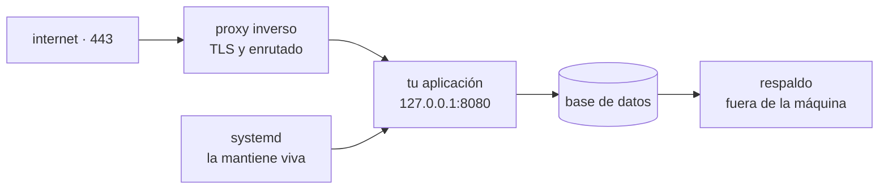

**Dónde estás:** hasta ahora el código vivía en tu máquina y en un repositorio. Aquí sale por primera vez: una máquina ajena, una IP pública y usuarios que pueden llegar a ella.

## Qué hace falta para responder una petición

Es tentador pensar que desplegar es copiar archivos a un servidor. No lo es. Entre el código y una petición contestada hay cuatro piezas, y cada una resuelve un problema distinto:

- El **proxy** resuelve que solo un proceso puede ocupar el puerto 443, y concentra el certificado.
- El **supervisor** resuelve que un proceso arrancado a mano muere con tu sesión y no vuelve tras un reinicio.
- El **cortafuegos** resuelve que una IP pública recibe intentos de acceso automatizados a las pocas horas de existir.
- El **respaldo** resuelve que un solo disco es un solo ejemplar de los datos.

Quitas cualquiera de las cuatro y el sistema sigue funcionando — hasta el día en que no.

## Por qué empezar aquí y no por contenedores

Puedes desplegar con Docker sin haber configurado nunca un servidor a mano. Mucha gente lo hace. El problema aparece cuando algo falla: un contenedor que no arranca, un puerto que no responde, un certificado caducado. Sin haber visto esas piezas por separado, todo se parece a que "Docker no funciona".

Este módulo las separa. Después, un contenedor deja de ser magia y pasa a ser lo que es: una forma de empaquetar la aplicación y sus dependencias, que no te ahorra ni el proxy, ni el certificado, ni el respaldo.

## El recorrido

| Momento | Pregunta | Página |
| --- | --- | --- |
| Acceso | ¿Cómo entro sin dejar la puerta abierta? | [Aprovisionar una VPS](/server/provisioning/) |
| Arranque | ¿Cómo llega el código y con qué configuración corre? | [Desplegar a mano](/server/manual-deploy/) |
| Permanencia | ¿Qué lo mantiene vivo cuando cierro la terminal? | [Mantener la aplicación viva](/server/processes/) |
| Entrada | ¿Cómo llega el tráfico y de dónde sale el HTTPS? | [Proxy inverso y certificados](/server/proxy-tls/) |
| Datos | ¿Qué pasa si este disco desaparece? | [Respaldos](/server/backups/) |
| Práctica | ¿Puedo hacer el camino completo? | [Práctica · de VPS vacía a HTTPS](/server/lab-vps-deploy/) |

:::note[Una VPS sigue siendo una opción seria]
Que existan Kubernetes y las plataformas administradas no convierte a un servidor único en un error. Para la mayor parte de los proyectos es más barato, más simple de diagnosticar y suficiente durante mucho más tiempo del que se supone. Lo que hay que saber es cuándo deja de serlo.
:::

## Qué cubre

Estas páginas cubren el camino desde una VPS recién creada hasta una aplicación servida por HTTPS, que sobrevive a un reinicio, con los puertos cerrados y un respaldo que sale de la máquina.

## Dónde se rompe esto

| Síntoma | Qué lo causa | Dónde sigue |
| --- | --- | --- |
| El servidor nuevo no queda igual que el anterior | Los pasos existen en tu memoria y en ningún archivo | [Contenedores](/containers/) |
| Descubres que el código no arranca cuando ya está en el servidor | La primera comprobación ocurre en el peor sitio posible | [Integración continua](/integration/) |
| Cada actualización es entrar por SSH y repetir la misma secuencia | El despliegue depende de que una persona esté disponible | [Del build al release](/deployment/pipeline/) |
| Actualizar corta el servicio unos segundos | Se para la versión vieja antes de que la nueva esté lista | [Estrategias de despliegue](/deployment/strategies/) |
