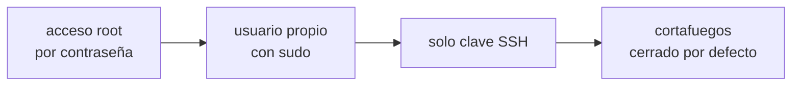

## Qué te acaban de entregar

Una **VPS** —*virtual private server*— es una máquina virtual con Linux, una dirección IP pública y nada más. Ningún proveedor —Hetzner, DigitalOcean, EC2— te la deja configurada: te la deja arrancada, con acceso de `root` y todos los puertos que el sistema haya abierto por su cuenta.

Ese estado inicial es cómodo y es exactamente el que no quieres mantener. Tres cosas lo cambian, en este orden.



## Entrar con clave, no con contraseña

Una contraseña viaja hasta el servidor cada vez que la usas, y se puede adivinar a fuerza de intentos: una IP pública recibe intentos de acceso automatizados a las pocas horas de existir.

Una **clave SSH** son dos archivos que se generan juntos. La *pública* se copia al servidor y no es secreta; la *privada* se queda en tu máquina y no sale nunca de ahí. Al conectarte, el servidor plantea un desafío que solo se puede resolver con la privada, así que demuestras tenerla sin llegar a enviarla.

```bash
ssh-keygen -t ed25519 -C "tu-correo@ejemplo.com"   # en TU máquina, no en el servidor
ssh-copy-id root@203.0.113.10                      # copia la pública al servidor
ssh root@203.0.113.10                              # ya no debería pedir contraseña
```

La frase de paso que pide `ssh-keygen` cifra la clave privada en tu disco. Ponla: sin ella, quien copie ese archivo entra a todos tus servidores.

## Un usuario propio

`root` puede hacer cualquier cosa, incluida la que no querías. Un usuario normal con permiso de `sudo` hace lo mismo, pero te obliga a escribir `sudo` delante de lo peligroso, y esa pausa es la que evita la mitad de los accidentes.

```bash
adduser marta                       # crea el usuario y pide su contraseña
usermod -aG sudo marta              # le da permiso para escalar cuando lo pida
rsync --archive --chown=marta:marta ~/.ssh /home/marta   # copia tu clave a su cuenta
```

Comprueba que puedes entrar como `marta` **desde otra terminal, sin cerrar la sesión de root**, antes de seguir. Si algo salió mal, la sesión abierta es tu única forma de arreglarlo.

## Cerrar la puerta de atrás

Con el usuario funcionando, quita las dos formas de entrar que ya no necesitas. En `/etc/ssh/sshd_config`:

```
PermitRootLogin no
PasswordAuthentication no
```

```bash
sudo systemctl restart ssh
```

A partir de aquí, un intento con contraseña se rechaza sin llegar a probarla, y la mayor parte de esos intentos automatizados dejan de tener sentido.

:::caution[No cierres la sesión hasta comprobarlo]
Reinicia SSH y, sin cerrar la terminal que ya tienes abierta, entra desde otra. Si te equivocaste en el archivo de configuración, esa sesión viva es lo único que te separa de tener que usar la consola de rescate del proveedor.
:::

## Solo los puertos que usas

`ufw` es la capa amable sobre el cortafuegos del sistema. La regla útil es la misma siempre: negar todo lo que entra, permitir todo lo que sale, y abrir a mano lo poco que hace falta.

```bash
sudo ufw default deny incoming
sudo ufw default allow outgoing
sudo ufw allow OpenSSH        # 22 — o el puerto en el que escuche tu SSH
sudo ufw allow 80/tcp         # HTTP, necesario para emitir certificados
sudo ufw allow 443/tcp        # HTTPS
sudo ufw enable
sudo ufw status verbose
```

Fíjate en lo que **no** está: el puerto de tu aplicación y el de la base de datos. Ninguno de los dos debería ser alcanzable desde internet — el proxy los alcanza por `127.0.0.1`, que no pasa por el cortafuegos.

## Que el sistema se parchee solo

Las actualizaciones de seguridad que nadie aplica no protegen de nada. En Debian y Ubuntu esto se resuelve en dos comandos:

```bash
sudo apt update && sudo apt upgrade -y
sudo apt install unattended-upgrades
```

## Comprueba lo que entendiste

<details>
<summary>¿Por qué una clave SSH es más segura que una contraseña larga?</summary>

Porque la contraseña viaja al servidor en cada conexión y se puede adivinar probando; la clave privada no sale nunca de tu máquina. El servidor plantea un desafío y tú devuelves una respuesta que solo se puede calcular teniendo la privada, así que nunca hay un secreto en tránsito que interceptar ni un valor finito que adivinar a fuerza de intentos.

</details>

<details>
<summary>Pusiste PasswordAuthentication no y reiniciaste SSH. ¿Qué tenías que haber hecho antes?</summary>

Comprobar, desde una segunda terminal y sin cerrar la que ya tenías abierta, que la entrada con clave funciona para tu usuario nuevo. Si la clave no estaba bien copiada, acabas de quitarte a ti mismo la única forma de entrar, y solo queda la consola web del proveedor.

</details>

<details>
<summary>Tu base de datos escucha en el puerto 5432 y ufw no lo abre. ¿Puede la aplicación conectarse?</summary>

Sí, si ambas corren en la misma máquina y se conectan por `127.0.0.1`. El tráfico local no atraviesa el cortafuegos. Eso es exactamente lo que quieres: la aplicación llega y el resto de internet no.

</details>

## Sigue explorando

- [SSH · autenticación con clave pública](https://www.ssh.com/academy/ssh/public-key-authentication) — cómo funciona el desafío por dentro.
- [ufw · guía de Ubuntu](https://help.ubuntu.com/community/UFW) — la referencia de reglas y perfiles.
- [unattended-upgrades](https://wiki.debian.org/UnattendedUpgrades) — qué se actualiza solo y qué no.
