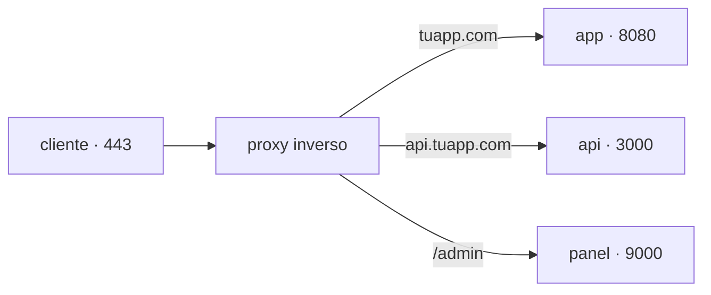

## Un solo 443 para muchos servicios

Tu servidor tiene una IP y una aplicación escuchando en el puerto 8080. El navegador de un usuario no conoce ese puerto: pide `https://tuapp.com`, que significa el puerto 443. Y mañana quieres alojar ahí una segunda aplicación, y una API, y el panel de administración.

No pueden escuchar todas en 443: un puerto lo ocupa un proceso. Hace falta algo delante que reciba todo el tráfico y decida a dónde va cada petición.



Eso es un **proxy inverso**: un servidor que recibe las peticiones en nombre de tus servicios y las reenvía al que corresponde. Se llama "inverso" porque un proxy normal representa al cliente ante internet; este representa al servidor ante el cliente, que nunca sabe qué hay detrás.

## Qué te compra

Enrutar es solo la primera razón. Un proxy inverso concentra en un punto cuatro cosas que si no tendrías que resolver en cada aplicación:

- **TLS.** El certificado se instala y se renueva en un solo lugar. El proxy descifra la conexión y habla con tus servicios por la red interna. Se le llama *terminación TLS*.
- **Superficie mínima.** Tus servicios dejan de publicar puertos al exterior: solo el proxy es alcanzable desde internet, y el resto escucha en `127.0.0.1`, donde nadie de fuera llega.
- **Reglas comunes.** Límites de tamaño y de frecuencia, cabeceras de seguridad, compresión, tiempos de espera: se escriben una vez y valen para todo lo que hay detrás.
- **Un único registro de acceso.** Todas las peticiones pasan por el mismo sitio, así que hay un solo lugar donde ver qué está entrando.

```nginx
server {
  listen 443 ssl;
  server_name tuapp.com;
  ssl_certificate     /etc/letsencrypt/live/tuapp.com/fullchain.pem;
  ssl_certificate_key /etc/letsencrypt/live/tuapp.com/privkey.pem;

  location / {
    proxy_pass http://127.0.0.1:8080;   # el servicio solo escucha en local
    proxy_set_header Host $host;
    proxy_set_header X-Forwarded-For $remote_addr;
    proxy_set_header X-Forwarded-Proto $scheme;
  }
}
```

Las dos líneas `ssl_certificate` no las escribes tú: las añade Certbot al emitir el certificado, como verás más abajo. Sin ellas nginx rechaza el bloque.

Las cabeceras importan más de lo que parece: sin ellas tu aplicación cree que todas las peticiones vienen del proxy y no del usuario, los logs dejan de servir para investigar nada, y cualquier redirección que construya saldrá en `http://` aunque el usuario haya entrado por HTTPS.

## De dónde sale el certificado

Un certificado es la prueba de que el dominio es tuyo. Lo emite una **autoridad certificadora** después de comprobarlo, y el navegador solo confía en las que ya trae en su lista.

Let's Encrypt emite gratis y de forma automática mediante el protocolo **ACME**: pides un certificado para `tuapp.com`, la autoridad te plantea un reto —normalmente, publicar un archivo bajo `http://tuapp.com/.well-known/acme-challenge/`—, y al resolverlo demuestras que controlas ese dominio. Certbot hace las dos partes por ti.

```bash
sudo apt install certbot python3-certbot-nginx
sudo certbot --nginx -d tuapp.com -d www.tuapp.com
```

Certbot edita tu configuración de nginx para añadir el bloque TLS y la redirección de 80 a 443, y deja instalado un temporizador que renueva antes de que caduque.

```bash
systemctl list-timers | grep certbot     # ¿está programada la renovación?
sudo certbot renew --dry-run             # ensayo, sin pedir nada de verdad
```

:::caution[Lo que falla es la renovación, no la emisión]
Un certificado de Let's Encrypt dura 90 días. Emitirlo a mano una vez funciona; acordarse cada tres meses, no. Comprueba el temporizador el mismo día que lo emites, porque el fallo se manifiesta noventa días después y como una caída total: el navegador no muestra el sitio, muestra una advertencia.
:::

:::note[Caddy, Traefik, nginx: el mismo papel]
Cambia la sintaxis y cuánto se automatiza —Caddy pide y renueva certificados solo, sin Certbot; Traefik se configura leyendo etiquetas de los contenedores—, pero los tres ocupan el mismo sitio en el diagrama. Elige por operación, no por rendimiento: para casi cualquier carga real, los tres sobran.
:::

## Comprueba lo que entendiste

<details>
<summary>Tu aplicación registra que todas las peticiones vienen de 127.0.0.1. ¿Qué falta?</summary>

La cabecera `X-Forwarded-For`. Desde el punto de vista de la aplicación, quien se conecta es el proxy, porque literalmente lo es. El proxy tiene que reenviar la dirección original en una cabecera, y la aplicación tiene que estar configurada para confiar en ella —solo cuando el proxy es tuyo, porque una cabecera la puede escribir cualquiera.

</details>

<details>
<summary>¿Por qué el sitio dejó de cargar exactamente noventa días después de ponerlo en marcha?</summary>

Porque el certificado caducó y la renovación automática no estaba funcionando. El día de la emisión todo se ve bien, así que el fallo aparece un trimestre después, cuando nadie está mirando. Un `systemctl list-timers` y un `certbot renew --dry-run` el primer día lo habrían mostrado.

</details>

<details>
<summary>Tu aplicación escucha en 0.0.0.0:8080 y el proxy la reenvía. ¿Qué queda mal?</summary>

Que el puerto 8080 sigue siendo alcanzable desde internet, así que cualquiera puede saltarse el proxy y con él el TLS, los límites y el registro. La aplicación debe escuchar en `127.0.0.1:8080`, y el cortafuegos permitir solo 22, 80 y 443.

</details>

## Sigue explorando

- [nginx · guía del proxy inverso](https://docs.nginx.com/nginx/admin-guide/web-server/reverse-proxy/) — la configuración en su forma canónica.
- [Let's Encrypt · cómo funciona](https://letsencrypt.org/es/how-it-works/) — el protocolo ACME y los tipos de reto.
- [Caddy · reverse_proxy](https://caddyserver.com/docs/caddyfile/directives/reverse_proxy) — el mismo papel con certificados automáticos.
