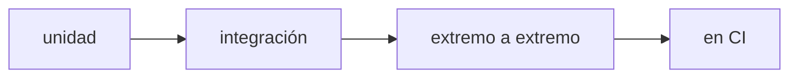

## Probar es afirmar con evidencia

Una prueba automática es una afirmación ejecutable: dado cierto input, el sistema responde de cierta forma. Cuando falla, no discutes opiniones; lees una evidencia concreta y reproducible.

En Fundamentos aprendiste a observar; en Colaboración, a revisar; en Entrega, a empaquetar. Probar cierra el círculo: convierte "creo que funciona" en "puedo demostrar que funciona".

## El recorrido

| Momento | Pregunta | Página |
| --- | --- | --- |
| Pirámide | ¿Qué probar y en qué nivel? | [La pirámide de pruebas](./pyramid/) |
| Automatización | ¿Cómo corren las pruebas en cada cambio? | [Pruebas en CI](./in-ci/) |
| Práctica | ¿Puedo escribir y ejecutar una prueba? | [Lab · tu primera prueba](./lab-first-test/) |

:::note Una prueba que nunca falla no protege nada
Si una prueba pasa siempre, aunque rompas el código, no está probando lo que crees. Una buena prueba falla cuando el comportamiento cambia.
:::

## Resultado esperado

Al terminar podrás distinguir los niveles de prueba, decidir qué automatizar en CI y escribir una primera prueba que falle por la razón correcta.
