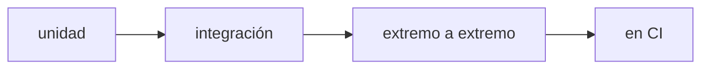

**Dónde estás:** en Fundamentos aprendiste a observar; en Colaboración, a revisar; en Contenedores, a empaquetar. Probar añade lo que falta: convierte "creo que funciona" en "puedo demostrar que funciona".

## Probar es afirmar con evidencia

Una prueba automática es una afirmación ejecutable: dado cierto input, el sistema responde de cierta forma. Cuando falla, no discutes opiniones; lees una evidencia concreta y reproducible.

Si ya programas, probablemente esto no sea nuevo. Lo que cambia en DevOps es dónde vive la suite: deja de ser una comprobación que corres cuando te acuerdas y pasa a ser una **compuerta del camino de entrega**. Se ejecuta sola en cada cambio, en un entorno limpio que no es el tuyo, y su resultado decide si el artefacto sigue avanzando. Una prueba deja de ser tu seguro personal y pasa a ser evidencia compartida.

## El recorrido

| Momento | Pregunta | Página |
| --- | --- | --- |
| Pirámide | ¿Qué probar y en qué nivel? | [La pirámide de pruebas](/testing/pyramid/) |
| Práctica | ¿Puedo escribir y ejecutar una prueba? | [Práctica · tu primera prueba](/testing/lab-first-test/) |

:::note[Una prueba que nunca falla no protege nada]
Si una prueba pasa siempre, aunque rompas el código, no está probando lo que crees. Una buena prueba falla cuando el comportamiento cambia.
:::

## Qué puedes hacer con esto

Con estas páginas puedes distinguir los niveles de prueba, elegir qué automatizar y escribir una primera prueba que falle por la razón correcta.

## Dónde se rompe esto

| Síntoma | Qué lo causa | Dónde sigue |
| --- | --- | --- |
| La suite pasa en tu máquina y falla en la de otra persona | Las pruebas corren donde ya está todo instalado, y nadie comprueba en limpio | [Pruebas en CI](/integration/tests-in-ci/) |
| Alguien integra un cambio sin haber ejecutado las pruebas | La suite es un hábito personal, no una compuerta del camino de entrega | [Integración continua](/integration/) |
| La suite verde no dice nada sobre lo que ya está en producción | Una prueba afirma sobre el código, no sobre el servicio en marcha | [Observabilidad](/scaling/observability/) |
