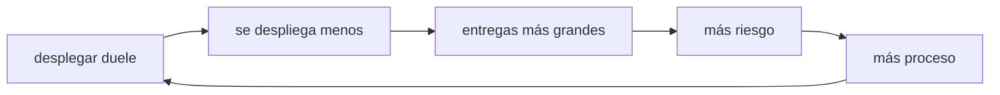
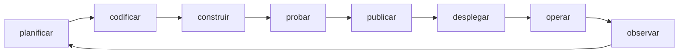

## Empieza con un muro

Durante años, construir software y operarlo fueron dos trabajos separados, con incentivos opuestos:

- **Desarrollo** existe para cambiar el sistema. Se le mide por funcionalidades entregadas.
- **Operaciones** existe para mantenerlo en pie. Se le mide por estabilidad.

Cada cambio que uno entrega es un riesgo que el otro absorbe. Entre ambos aparece un muro, y sobre el muro se lanza una entrega: aquí está el código, que corra.

Ese muro se retroalimenta solo. Si desplegar duele, se despliega menos seguido. Si se despliega poco, cada entrega acumula más cambios. Cuanto más grande la entrega, más riesgosa. Cuanto más riesgosa, más proceso se le añade. Y cuanto más proceso, menos seguido se despliega.

Cuando algo falla en producción, nadie tiene el sistema completo en la cabeza: quien lo escribió no lo ve correr, y quien lo ve correr no lo escribió.

## Qué es DevOps, entonces

**DevOps es una forma de trabajar en la que quien construye un sistema también responde por cómo se comporta en producción, y en la que cada paso entre un commit y un usuario es automatizado, observable y reversible.**

No es una tecnología. Es la decisión de tratar "construir" y "operar" como un solo trabajo, más el conjunto de prácticas y herramientas que hacen que esa decisión sea sostenible: si un equipo va a responder por su propio sistema en producción, necesita que entregar sea barato, que el estado sea visible y que volver atrás sea rápido.

De ahí sale todo lo demás. Las herramientas que verás en este Atlas —Git, Docker, CI/CD— existen para bajar el costo de ese ciclo, no al revés.

:::note[DevOps no se instala]
Ninguna herramienta convierte a un equipo en DevOps. Automatizar un traspaso roto solo hace que el traspaso falle más rápido.
:::

## Qué no es

- **No es un equipo aparte.** Un "equipo DevOps" ubicado entre desarrollo y operaciones es el muro anterior con un nombre nuevo: sigue habiendo un traspaso y sigue habiendo alguien que absorbe el riesgo de otro.
- **No es solo automatización.** Automatizar es el medio. El fin es acortar el ciclo entre una idea y la evidencia de que funciona.
- **No es "la persona del pipeline".** El pipeline es una consecuencia visible de la práctica, no su definición.
- **No es un reemplazo del desarrollo.** Asume que ya sabes construir software; añade lo que le pasa a ese software después de que compila.

## El ciclo completo

Un cambio de software recorre siempre el mismo ciclo, y lo importante es que **es un ciclo**: lo que aprendes operando el sistema vuelve a la planificación.

| Etapa | Pregunta que responde |
| --- | --- |
| Planificar | ¿Qué vamos a cambiar y por qué? |
| Codificar | ¿Cómo lo escribimos y cómo lo revisamos entre varias personas? |
| Construir | ¿Cómo se convierte el código en algo instalable? |
| Probar | ¿Cómo demostramos que hace lo que dice? |
| Publicar | ¿Qué versión exacta queda disponible para desplegar? |
| Desplegar | ¿Cómo llega a producción sin tumbar el servicio? |
| Operar | ¿Quién responde cuando falla y con qué salida de emergencia? |
| Observar | ¿Qué está pasando de verdad ahí dentro? |

Si vienes del desarrollo, ya vives la mitad izquierda del ciclo. DevOps es, en la práctica, hacerte cargo de la mitad derecha —y sobre todo de la flecha que cierra el círculo.

## Tres ideas que sostienen el resto

Casi todo lo que leerás en este Atlas se apoya en tres ideas. Cuando una recomendación parezca arbitraria, suele reducirse a una de estas.

**1 · Flujo: pequeño y seguido es más seguro que grande y raro.**
Suena al revés, porque desplegar más veces parece exponerse más veces. Pero un cambio pequeño se revisa de verdad, se entiende completo y, cuando falla, se sabe qué lo causó: solo cambió una cosa. Diez cambios juntos fallando son diez sospechosos.

**2 · Retroalimentación: sirve la que llega temprano.**
Un error detectado al escribir cuesta minutos; el mismo error detectado en producción cuesta un incidente. Por eso las comprobaciones se ordenan de barata a cara, y por eso importa que un fallo señale su causa en vez de decir "falló".

**3 · Reversibilidad: poder volver atrás vale más que no fallar nunca.**
Ningún sistema deja de fallar. La diferencia entre un equipo tranquilo y uno que reza antes de desplegar no es la cantidad de errores: es cuánto tarda en deshacerlos.

## Qué hace alguien en este rol

El día a día varía mucho por empresa, pero el trabajo suele mezclar:

- Construir y mantener el camino automático que va del commit a producción.
- Empaquetar aplicaciones para que corran igual en cualquier máquina.
- Definir y versionar la infraestructura en vez de configurarla a mano.
- Operar entornos: despliegues, versiones, configuración, secretos, permisos.
- Investigar fallos con evidencia en lugar de suposiciones.
- Decidir cómo se despliega y cómo se revierte, antes de necesitarlo.
- Medir el sistema para saber si está sano sin esperar a que alguien se queje.

El título del puesto cambia —DevOps engineer, platform engineer, SRE— y cada uno pone el acento en un punto distinto, pero los problemas de fondo son los mismos.

## Dónde encaja cada módulo

Este Atlas te lleva desde leer una máquina hasta desplegar una versión, observar cómo se comporta y poder revertirla. Cada módulo se ocupa de un tramo del ciclo:

| Etapa del ciclo | Dónde se cubre |
| --- | --- |
| Leer una máquina y una red | [01 · Fundamentos](/foundations/) |
| Codificar y revisar en equipo | [02 · Colaboración](/collaboration/) |
| Poner la aplicación en una máquina y mantenerla viva | [03 · Un servidor](/server/) |
| Empaquetar la aplicación | [04 · Contenedores](/containers/) |
| Probar con evidencia | [05 · Pruebas](/testing/) |
| Comprobar cada cambio automáticamente | [06 · Integración continua](/integration/) |
| Publicar, desplegar y revertir | [07 · Despliegue continuo](/deployment/) |
| Observar, medir y crecer | [08 · Escalar](/scaling/) |
| Describir la infraestructura en vez de configurarla | [09 · Infraestructura como código](/infrastructure/) |

**Lo que todavía no encontrarás aquí:** nubes públicas y seguridad. De Kubernetes verás por qué existe y cuándo compensa, pero no cómo operarlo. Cuando una página necesita apoyarse en alguno de esos temas, lo dice y te enlaza a una fuente externa.

:::caution[Prerrequisito]
Este Atlas asume que ya programas: que sabes escribir código, usar un editor y leer un error. No enseña a programar desde cero.
:::

## Cómo encontrar lo que buscas

- **Si empiezas de cero**, lee en orden: los módulos van del 01 al 09 y cada uno se apoya en el anterior.
- **Si vienes por algo concreto**, usa el buscador o el [índice de herramientas A–Z](/tools/) y entra directo a la página.

Cada página indica a qué módulo pertenece y qué conviene saber antes, así que puedes entrar por el medio sin quedarte sin contexto.

Todo el contenido existe en español y en inglés: cambias de idioma cuando quieras y sigues en la misma página.

## Comprueba lo que entendiste

Una empresa crea un "equipo DevOps" entre desarrollo y operaciones. ¿Qué problema reaparece?

El muro. Sigue existiendo un traspaso, y sigue habiendo un equipo que absorbe el riesgo de los cambios que otro escribió. Solo se movió la frontera de sitio: ahora hay dos traspasos en vez de uno.

Si cada despliegue puede fallar, ¿por qué desplegar más seguido reduce el riesgo?

Porque el riesgo no está en la cantidad de despliegues, sino en el tamaño de cada uno. Un despliegue pequeño cambia una cosa: es fácil de revisar, su fallo tiene un solo sospechoso y revertirlo devuelve el sistema a un estado conocido. Acumular cambios no evita el fallo, solo lo hace más difícil de diagnosticar.

## Sigue explorando

- [DORA · State of DevOps](https://dora.dev/) — la investigación que midió qué prácticas se correlacionan con equipos rápidos y estables.
- [Google SRE Book](https://sre.google/sre-book/table-of-contents/) — cómo se opera un sistema en serio (gratis en línea).
- [The Twelve-Factor App](https://12factor.net/es/) — un conjunto compacto de decisiones que hacen operable una aplicación.
